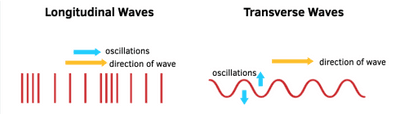
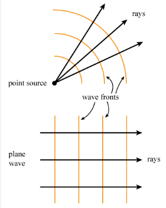
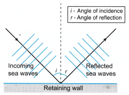
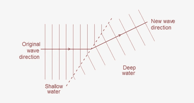
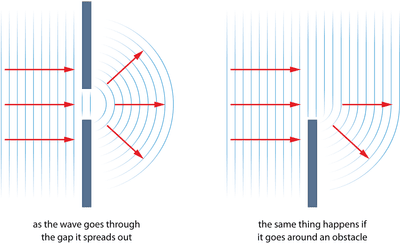

# Waves

## General Properties of Waves

- Progressive waves carry energy from one place to another without transferring matter.

**Two Types of Progressive Waves**

- Transverse waves

- Longitudinal waves



- Wavelength ($\lambda$): Distance between 2 successive crests/ troughs.

- Frequency ($f$): Number of complete waves created per second, measured in hertz (Hz).

- Wave speed ($v)$: Distance moved by a crest or any point on the wave in 1 second.

- Amplitude ($a$): Height of a crest or depth of a trough from the undisturbed or mean position.

- Phase: Particles in ‘phase’ have the same speed and direction of vibration.

<b>Wave equation</b>

- Faster vibration produces a shorter wavelength.

- Therefore, a higher frequency results in a smaller wavelength.

- Wave equation:

  ```
                        v = f x λ
  ```

<b>Wavefronts and rays</b>

- **Wavefront:** A straight line where the wave has the same phase at all points.

- **Ray:** Line drawn at right angles to a wavefront showing the direction of travel.



<b>Reflection of a wave at a plane surface</b>

- Straight water waves (transverse waves) hit a metal strip in a ripple tank at $x$° angle.

- Angle of incidence $(i)$ and angle of reflection $(r)$are both $x$° .

- Angle of incidence equals angle of reflection: $( i = r )$

- Same wavelength as reflected wave

- Same wave speed    **Refraction**

- Continuous straight waves in shallow water have shorter wavelengths than in deeper water.

- Waves in shallower water have a smaller speed and smaller wavelength.

- When waves move from less dense to more dense regions, they bend towards the normal (water waves speed up due to larger wavelengths), (light waves slow down due to smaller wavelengths)

- When waves move from dense to less dense regions, they bend away from normal (water waves slow down due to smaller wavelengths), (light waves speed up due to bigger wavelengths)



<b>Diffraction</b>

- Straight water waves meet narrow gaps and create circular wavefronts.

- Diffraction can also occur at the edges of obstacles causing wave spreading.

