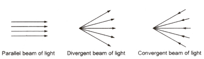
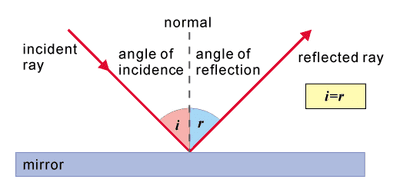
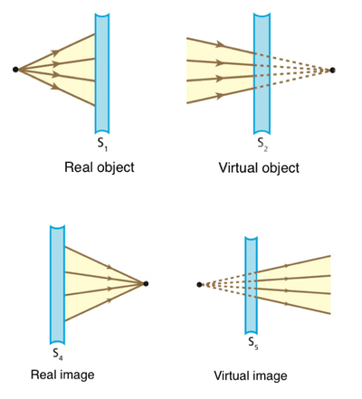
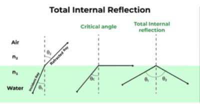

## Reflection and Refraction of Light

* Light travels in a path called a ray.
* A beam is a stream of light shown by several rays.
* Beams can be parallel, diverging, or converging.

 

**Speed of Light**

* The speed of light is about 1 million times faster than the speed of sound.
* The speed of light is $3 \times 10^8$ meters per second.

**Reflection of light against a plane mirror**

* The normal is perpendicular to the mirror at the point where the incident ray strikes.
* The angle of incidence $(i)$ is between the incident ray and the normal.
* The angle of reflection $(r)$ is between the reflected ray and the normal.

> The law of reflection states that the angle of incidence is equal to the angle of reflection.

 

**Real and Virtual Images**

* A real image can be produced on a screen and is formed by rays that pass through the screen.
* A virtual image cannot be formed on a screen.
* A virtual image is produced by rays that seem to come from it but do not pass through it.
* The image in a plane mirror is virtual. Rays from an object are reflected at the mirror and appear to come from a point behind the mirror where the rays would meet when extrapolated (extended) backward.  

**Refractive Index**

* Light refracts due to speed change when entering a different medium.
* In air, light travels at $300,000 $ $km/s$ ($3 × 10⁸$ $m/s$)
* In glass, it slows to 200,000 $km/s$ (2 × 10⁸ $m/s$)
* Refractive index $( n )$ is the ratio of light speed in air to light speed in the medium.
* For glass: $n = \frac{300,000  \text{km/s}}{200,000 \text{km/s}} = \frac{3}{2} = 1.5$
* Refractive index is the ratio of speeds of a wave in two different regions.
* Experimentally it is true that $n = \frac{\sin(i)}{\sin(r)}$  where $( i )$ is the angle in air and $( r )$ is the angle in glass.
* Higher refractive index means greater bending of light as it slows down more.

**Critical Angle**

* When light passes from an optically denser to an optically less dense medium at small angles of incidence, there is a strong refracted ray and a weak reflected ray.
* Increasing the angle of incidence increases the angle of refraction.
* Critical angle ($c$) occurs when the angle of refraction is 90°.
* For angles of incidence greater than ($c$), light undergoes total internal reflection.
* Total internal reflection means that the light does not cross the boundary and reflects inside the denser medium.
* For the critical angle: $\sin(c) = \frac{1}{n}$  where $n$ is the refractive index.

