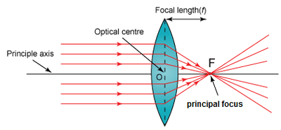
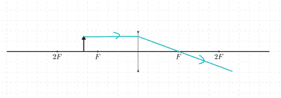
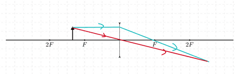
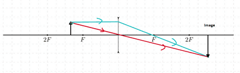
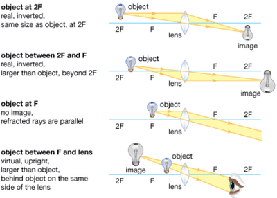

## Lenses

**Converging and Diverging Lenses**

* A converging (or convex) lens is thickest in the center and bends light inwards.
* A diverging (or concave) lens is the thinnest in the center and spreads the light out.
* The center of a lens is its optical center $(C)$ and the line through $C$ at right angles to the lens is the principal axis.

**Principal focus**

* When a beam of light (parallel to the principal axis) passes through a converging lens, it refracts to converge at a point called the principal focus $(F)$.
* The principal focus of a converging lens is a real focus.
* A diverging lens has a virtual principal focus behind the lens, from which the refracted beam **appears** to diverge.
* A lens has two principal focuses, one on each side, each equidistant from the optical center $(C)$.
* The distance ($CF$) is the focal length $(f)$ of the lens. 

**Ray diagrams**

* A ray parallel to the principal axis is refracted through the principal focus $(F)$.
* A ray through the optical center $(C)$ is undeviated (not refracted) for a thin lens.
* A ray through the principal focus $(F)$ is refracted parallel to the principal axis.
* The intersection of rays (in one beam) after refraction gives the location of the image.

**How to draw a ray diagram step-by-step**

Parallel Ray (Ray 1):

* Draw a straight line (parallel to the principal axis). 
* Start the line from the top of the object towards the lens. 
* After refraction through the lens, draw this direct ray through the focal point $F$ on the opposite side of the lens. 

Central Ray (Ray 2):

* Draw a straight line from the top of the object through the optical center $C$ of the lens.
* This ray will continue in the same direction without bending at all. 

Image formed:

* These two  will intersect on the opposite side of the lens to form the image of the object. 

**Magnification**

* The linear magnification $(M)$ is given by: 

  $M = \frac{\text{image size}}{\text{object size}}$
* Magnification can also be expressed as:  

  $M = \frac{\text{distance of image from lens}}{\text{distance of object from lens}}$ 

* Image properties at different object positions are shown below:

| Object Position | Image Position | Image Nature | Image Size |
|----|----|----|----|
| At 2F | At 2F | Real, inverted | Same size |
| Between 2F and F | Beyond 2F | Real, inverted | Larger |
| At F | At infinity | Real, inverted | Infinitely large |
| Between F and lens | On the same side of lens | Virtual, upright | Larger |

 

**Applications of Lenses in Vision Correction**
- **Short-Sightedness (Myopia)**
  - **Cause:** The eye lens focuses light in front of the retina instead of on it. This causes distant objects to appear blurry.
  - **Correction:** A diverging (concave) lens is used to spread out light rays before they enter the eye, so the lens can focus them correctly on the retina.
- **Long-Sightedness (Hypermetropia)**
  - **Cause:** The eye lens focuses light behind the retina. This causes nearby objects to appear blurry.
  - **Correction:** A converging (convex) lens is used to focus light rays closer together before they enter the eye, so they focus correctly on the retina.