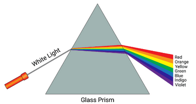

## Dispersion of Light

**Refraction by a Prism**

* In a triangular glass prism, a ray bends due to refraction at each surface.
* The bending at the first surface combines with the bending at the second surface.
* This combined change in direction is called the **deviation**.
* Unlike in a parallel-sided block, where the emergent (exiting) ray remains parallel to the incident ray, these bendings do not cancel out in a prism.

**Dispersion**

* When white light passes through a triangular glass prism, it separates into a band of colors known as a spectrum.
* This separation of colors is called **dispersion** and occurs because the refractive index of glass varies with the wavelength of light.
* White light consists of many colors with different wavelengths, and the prism separates them based on their refractive indices.
* The colors of the visible spectrum, from longest to shortest wavelength, are: red, orange, yellow, green, blue, indigo, and violet 
* Red light, with the longest wavelength and lowest frequency, is refracted the least by the prism.
* Violet light, with the shortest wavelength and highest frequency, is refracted the most by the prism. 

