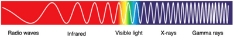
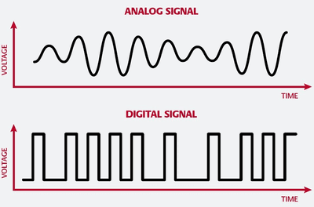
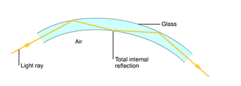

## Electromagnetic Spectrum

**Light waves and Electromagnetic Spectrum**

* Light is part of the electromagnetic spectrum, which extends beyond visible light in both directions (with greater wavelength vs. smaller wavelength)
* The spectrum includes gamma rays, X-rays, ultraviolet, infrared, microwaves, and radio waves.
* Wavelength increases from gamma rays to radio waves, while frequency increases from radio waves to gamma rays.    

**Properties of Electromagnetic Waves**

* Electromagnetic waves travel at the speed of light in a vacuum, approximately $3 \times 10^8$ $m/s$.
* They can undergo reflection, refraction, and diffraction and are transverse waves.
* They follow the wave equation $v = f \lambda$, where ($ v $) is the speed of light, ($ f $) is the frequency, and ($\lambda$) is the wavelength.
* Higher frequency means smaller wavelength and therefore more energy carried.

**Radio Waves and Microwaves**

* Radio waves are the longest-wavelength electromagnetic waves used for communication, radio and television transmission, astronomy, and radio frequency identification.
* Microwaves have shorter wavelengths than radiowaves and are used in telecommunications, satellite communication, radar, and microwave ovens.

**Infrared Radiation**

* Detected as heat by the body; used in thermal imaging, heating, and remote controls.
* Also used in communication (optical fibers), electric grills, and intruder alarms.
* However, high-intensity infrared can cause burns and eye damage.

**Visible Light**

* Red light has the longest wavelength, and violet light has the shortest.
* Monochromatic light consists of one color (single frequency), where frequency is more responsible than wavelength to express the colour.
* Visible light enables vision and is used for illumination and photography.
* Optical instruments like microscopes and telescopes use light properties to form images.

**Ultraviolet Radiation**

* Shorter wavelengths than visible light; causes sunburn and skin damage.
* Used in fluorescent applications (e.g., security marking, water treatment, artificial skin-tanning) and sterilising water.
* Can be harmful in high doses.

**X-rays and Gamma Rays**

* X-rays have smaller wavelengths than ultraviolet rays and are used in medical imaging, security screening, and industrial inspection.
* Gamma rays are highly penetrating (smallest wavelength and largest frequency) and used in cancer detection cancer treatment to kill cells, sterilization, and material inspection.

**Communication Systems**

* Below are the differences between digital and analog signals:

| **Aspect** | **Digital Signals** | **Analog Signals** |
|----|----|----|
| **Signal Type** | Discrete, binary (0s and 1s) | Continuous, varying amplitude and frequency |
| **Transmission Rate** | Higher transmission rates | Limited by bandwidth and signal degradation over distance |
| **Examples** | Digital data, internet signals, computer memory | Audio signals, analog television, older telephone systems |

 **Infrared Optical Fibers**

* Infrared optical fibers use the principle of total internal reflection to make infrared or light travel along the fiber without much loss.
* Used for long-distance data transmission, offering high bandwidth and low signal loss compared to electrical transmission.

 