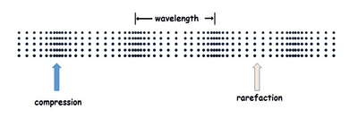
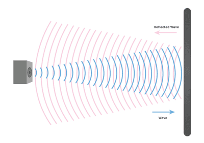
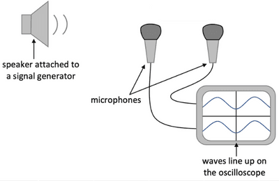
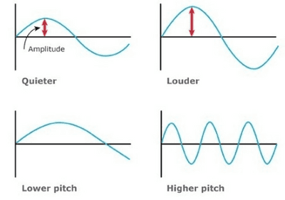

## Sound

**Longitudinal Waves**

* Sound waves are longitudinal
* Particles in the medium (like air or water molecules) vibrate back and forth parallel to the direction of wave propagation.
* This creates areas of compression (where molecules are closer together) and rarefaction (where they are far apart) as the wave travels through the medium.
* The movement of particles transfers energy through the medium.
* This vibration causes the sound to be heard

**Compressions and Rarefactions**

* Sound waves are made of compressions ($C$) and rarefactions ($R$) as they move through a medium.
* Compressions are regions where air molecules are densely packed together and the regions have higher pressure.
* Rarefactions are regions where air molecules are less densely packed and the regions have lower pressure.  

**Frequency and Wavelength**

* Frequency $(f)$ of a sound wave is the number of complete wave cycles per second and is measured in Hertz ($Hz$).
* Higher frequencies mean higher-pitch sounds, while lower frequencies mean lower-pitch sounds.
* Wavelength ($\lambda$) is the distance between two consecutive compressions or rarefactions in a sound wave.
* The speed of sound ($v$) in a medium is determined by the product of its frequency and wavelength: ($v = f \lambda$).

**Limits of hearing**

* Humans can only hear sound frequencies ranging from about 20$Hz$ (low pitch) to 20,000$Hz$ (high pitch).
* The upper limit of audibility decreases with age due to changes in the sensitivity of the ear.
* Audibility can also be affected by the intensity (loudness) of the sound which is determined by amplitude.

**Reflection of sound (Echo)**

* Sound waves reflect off hard and flat surfaces like how light reflects off a mirror.
* When sound reflects, it creates an echo, which is a repetition of the original sound heard after a short delay.  

**Speed of Sound**

* The speed of sound in air is approximately 330–350 meters per second ($m/s$) at room temperature.
* In other materials, such as water (with a speed of approx. 1500m/s) or steel (with a speed of approx. 5100 m/s), the speed of sound may vary due to differences in the density.
* Temperature affects the speed of sound in air and it increases with temperature because warmer air molecules move faster.

**Measurement of the Speed of Sound**

* **Echo Method**
* Stand at a known distance (more than 300m) from a large wall.
* Clap hands or produce a sharp sound and start a stopwatch simultaneously.
* Wait for the distinct echo from the surface and stop the stopwatch when you hear it.
* **Calculation:** Use the formula ($v = \frac{2d}{t}$), where ($d$) is the distance to the surface and ($t$ ) is the time interval measured with the stopwatch.

> Note: Twice the distance is used because the sound travels away from you and then back again, covering the entire distance two times.

**Direct Method**

* Place two microphones a known distance (like 10 meters) apart.
* Connect microphones to an oscilloscope to detect the sound.
* Produce a sound source equidistant from both points and start timing when the sound is produced.
* Stop timing when the sound is detected at the second point.
* Use the formula ($v = \frac{d}{t}$), where ($d$) is the known distance between the two microphones and ($t$) is the measured time interval between detection at the two points.  

**Musical Notes**

* The pitch of the note is determined by the frequency of the sound wave (higher frequencies produce higher pitch notes).
* Loudness is determined by the amplitude of vibrations ( greater amplitude produces louder sounds)
* Quality (timbre) of a sound is its unique shape or texture, caused by the instrument's construction.  

**Ultrasound**

* Ultrasound refers to sound waves with frequencies above the upper limit of human hearing ($>20,000Hz$).
* It is used in medical imaging and industrial applications for precision and non-destructive testing.
* Ultrasound waves behave similarly to audible sound waves but can penetrate materials and provide detailed imaging without harmful effects.