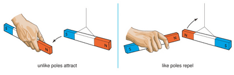
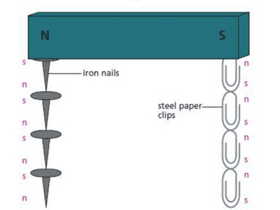
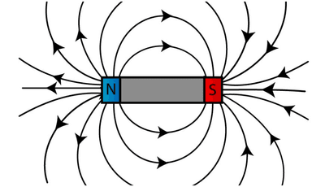
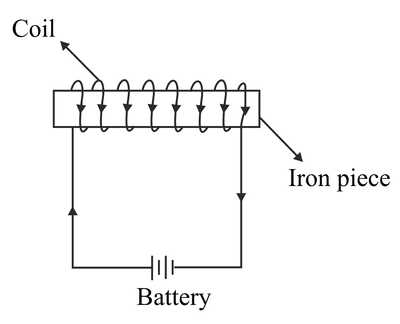

# Electricity and Magnetism

## Simple Phenomena of Magnetism

<b>Magnetic Materials</b>

- Ferromagnetic materials like iron can be made into magnets.

- Magnetic materials are naturally attracted to magnets even when not magnetized..

<b>Magnetic Poles</b>

- Magnetic poles attract magnetic materials and are found near the ends of magnets.

- Poles always come in pairs: north and south.

- Every magnet has a North Pole ($N$) and a South Pole ($S$).

- The North Pole of a magnet points towards the Earth's geographic North Pole.

<b>Law of Magnetic Poles</b>

- Similar poles ($N-N$ or $S-S$) repel each other.

- Opposite poles ($N-S$) attract each other.

- The attraction or repulsion decreases as poles move farther apart.     

<b>Induced Magnetism</b>

- Magnetic materials can become magnetized when near a magnet.

<b>Magnetisation of Iron and Steel</b>

- Iron nails and steel paper clips can be magnetised by hanging them from a magnet.

- Each nail or clip magnetises the next in a chain, with unlike poles attracting each other.

- Removing an iron chain by pulling the top nail causes it to collapse because iron shows temporary magnetism.

- Steel chains do not collapse when removed because they have permanent magnetism.

- Soft materials (e.g. iron) are easily magnetised but lose magnetism quickly.

- Hard materials (e.g. steel) are harder to magnetise but remain magnetised longer.     

<b>Magnetic and Non-magnetic Materials</b>

- Magnetic materials (iron, steel, nickel, cobalt) are attracted to magnets and can be magnetised.

- Non-magnetic materials (e.g., aluminium, wood) are not attracted to magnets and cannot be magnetised.

<b>Magnetic Fields</b>

- A magnetic field is the region around a magnet where magnetic forces act.

- Field strength is higher where magnetic field lines are closer together and lower where they are further apart.

- Magnetic fields are shown using lines of force, showing the direction from North to South poles.

- The density of these lines indicates field strength: closer lines represent stronger magnetic fields.     

<b>Electromagnets</b>

- They are formed from a coil of wire through which an electrical current passes.

- Magnetism is temporary and can be switched on and off, unlike permanent magnets.

- They contain a core of soft iron that only becomes magnetised when current flows through the coil.

<b>Factors Affecting Electromagnet Strength</b>

- Current Increase: Higher current in the coil results in stronger magnetism.

- More Turns: Increasing the number of turns in coils around the core increases magnet strength.

- Closer Poles: Moving the magnetic poles closer together increases electromagnet strength.     