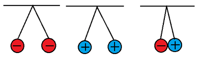
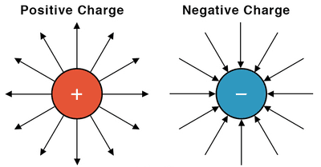
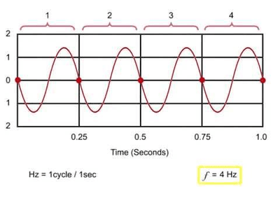

## Electrical quantities

**Electric Charge**

* Like/same charges (+ and + or – and – ) repel, while unlike charges (+ and –) attract.

**Force Between Charges**

* The force between electric charges decreases as their separation increases.
* Positive charges repel other positive charges and attract negative charges.
* Negative charges repel other negative charges and attract positive charges. 

**Charges, Atoms, and Electrons**

* Atoms consist of a central nucleus with protons (positive) and electrons (negative) orbiting around it.
* Protons and electrons have equal but opposite charges, making atoms electrically neutral overall.

**Production of Charges**

* Charges are produced by friction, which transfers electrons between materials.
* Electrons move between materials during rubbing; protons remain in the nuclei and do not move.

**Units of charge**

* Charge is measured in coulombs ($C$) and defined in terms of the ampere ($A$)
* The charge on an electron is ($e = -1.6 \times 10^{-19}$) $C$.

**Electrons, Insulators, and Conductors**

* Insulators: Electrons are firmly bound to atoms; rubbing can charge them statically.
* Conductors: Electrons can move freely; they require insulation to hold a charge.

| **Type** | **Description** | **Examples** |
|----|----|----|
| Insulators | Electrons are firmly bound to atoms; rubbing can charge them statically. | Plastics (polythene, cellulose acetate), Perspex, nylon |
| Conductors | Electrons can move freely; require insulation to hold a charge. | Metals, carbon |

**Electric Fields**

* When charges are near each other, they experience a force known as the electric force.
* Electric field is a region where a charge feels a force due to nearby charges.
* Uniform electric field exists between oppositely charged parallel metal plates, shown by evenly spaced lines perpendicular to the plates.
* The direction of the electric field is indicated by arrows, representing the force acting on a small positive test charge (pointing away from positive charges and towards negative charges). 

**The Ampere and the Coulomb (units of current and charge)**

* Electric Current is defined as charge passing a point per unit time, symbolized as

  ($I = \frac{Q}{t}$).
* Unit of current is the ampere ($A)$, with one milliampere ($mA$) equal to one-thousandth of an ampere and is measured by an ammeter.
* Unit of charge is the coulomb ($C$), defined as the charge passing a point when a steady current of 1 ampere flows for 1 second ($1C = 1As$).

**Charge Calculation**

$Q = I \times t$

where $Q$ is charge, $I$ is current, and $t$ is time in seconds.

**Conventional Current**

* Conventional current flows from positive to negative terminals of a battery, opposite to electron flow.
* Circuit diagrams show conventional current direction with arrows, while electrons move in the opposite direction.

**Direct and Alternating Current**

| Direct Current (d.c.) | Alternating Current (a.c.) |
|----|----|
| Electrons flow continuously  in one direction. | Electrons regularly change their direction of flow. |
| Provided by batteries | Produced by generators. |

**Frequency of Alternating Current**

* Frequency refers to the number of complete cycles per second.
* It is measured in Hertz ($Hz$), where 1 $Hz$ equals one cycle per second. 

