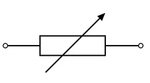
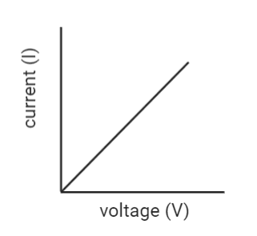
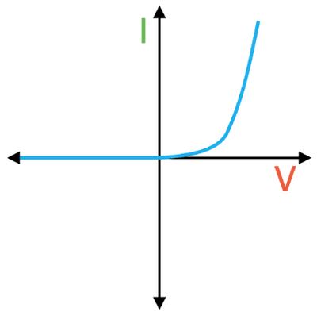
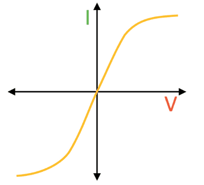
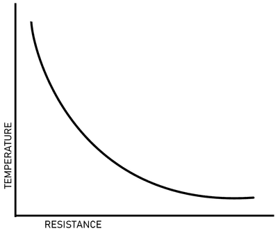
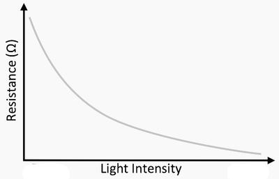

## Voltage, Resistance and Power

**Electromotive Force** $(e.m.f.)$

* Chemical actions inside a battery produce electron excess at the negative terminal and shortage at the positive terminal
* Battery maintains electron flow (electric current) in a connected circuit as long as chemical actions last.
* The battery does work when moving the charge around the circuit.
* Electromotive force ($e.m.f.$) is the electrical work done by a source in moving unit charge around a complete circuit.
* Electromotive force is measured in volts $(V)$.

**Potential Difference**

* Electric current transfers energy from a battery to circuit components and surroundings.
* Potential difference ($p.d.$) is the work done by unit charge passing through a component
* $P.d.$ is measured in volts.
* Voltage is sometimes used instead of $p.d.$
* 1 volt = 1 joule per coulomb 1 $V$ = 1 $\frac{J}{C}$ )
* Formula: $V = \frac{W}{Q}$ or $W = Q \times V$

**Resistance**

* Electrons move more easily through some conductors when $p.d.$ is applied.
* Resistance is the opposition of a conductor to current.
* Good conductors have low resistance while poor conductors have high resistance
* Ohm (Ω) is the unit of resistance.
* Formula: $R = \frac{V}{I}$

**Variable Resistors**

* They can change current in a circuit (rheostat mode) or act as a potential divider by dividing voltage across components as desired. 
* Resistance depends on the length, cross-sectional area, and material of the wire
* Resistance increases with length but decreases with a larger cross-sectional area
* Formula: ($R \propto \frac{l}{A}$)

$I–V$ **graphs and Ohm’s Law**

* Metals and some alloys give $I–V$ graphs that are straight lines through the origin, showing that $I$ is directly proportional to $V$ or that $I \propto V$.
* Doubling $V$ doubles $I$.
* Such conductors obey Ohm’s law: $V = IR$
* Ohmic or linear conductors are the conductors where resistance does not change with $V$. 

**Semiconductor Diode**

* Diode has small resistance when connected one way and very large resistance when $p.d.$ is reversed.
* It conducts electricity in one direction only, and it is a non-ohmic conductor. 

**Filament Lamp**

* Non-ohmic conductor at high temperatures
* $I–V$ graph curve flattens as $V$ and $I$ increase, showing increasing resistance with increasing current and increasing temperature. 

**Thermistor**

* An increase in temperature generally increases the resistance of metals.
* Thermistors' resistance is different and decreases with rising temperature.
* It is a non-ohmic conductor 

**Light-dependent Resistor (LDR)**

* Resistance of some semiconductors decreases with increased light intensity.
* Light-dependent resistors (LDRs) use this property to function.
* $I–V$ graph for an LDR is similar to that of a thermistor
* LDR is also a non-ohmic conductor.

  

**Power in Electric Circuits**

* Power defined as work done or energy transferred per time taken: $P = \frac{W}{t}$
* $ P$ is power in watts ($W$), $W$ is work done in joules ($J$), $t$ is time in seconds ($s$)
* For a steady current $(I)$ in a device with a potential difference ($V$) across it, the work done has a formula  $ W = I \times t \times V $
* Substituting work done with the power $P = IV$ multiplied by time in seconds ($t$), the energy transferred is: $E = Pt = IVt$

**Example**

* Lamp with 240 $V$ supply and 0.25 $A$ current
* Power = $P = IV$ = 240 $V$ $\times$ 0.25 $A$ = 60 $W$
* 60 $J$ of energy transferred to the lamp each second

**Voltage in terms of power and current**

* Volt can be defined as a watt per ampere:  $V = \frac{P}{I}$

* If all energy transferred to thermal energy in a resistor of resistance $R$:

  $P = V \times I$ = $IR$ $\times$ $I$ = $I^2R$

* Doubling the current produces four times the thermal energy per second  $P = I^2R$

* Larger unit for energy: kilowatt-hour ($kWh)$

* 1 $kWh$ = 1000 $\frac{J}{s}$ $\times$ 3600 $s$ = 3600000 $J$ = 3.6 $MJ$

* The cost of electricity in houses is calculated by using $kWh$ where each $kWh$ has a fixed price and is multiplied by the units you consume.