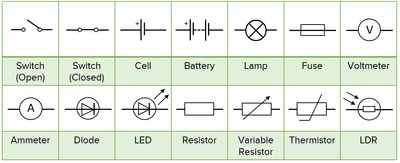
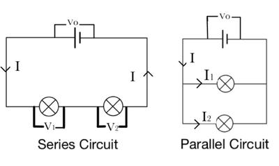

## Electric Circuits

**Electrical component symbols** 

 **Current in a Series Circuit**

* In a series circuit, there is a single path for the current to flow.
* The current remains the same throughout:
* Current ($I$) is consistent at every point in the series circuit.
* The reading on an ammeter will be identical no matter where it is placed in the circuit.

**Current in a Parallel Circuit**

* In a parallel circuit, components are connected side by side, providing alternative paths for current flow.
* The total current is the **sum of the currents** through each branch
* If the total current from the source is ($I_0$), and the current through each branch is $I_1, I_2$ and $I_3$ then $I_0 = I_1 + I_2 + I_3$ 

**Potential Difference** $(p.d.)$ **in Series and Parallel Circuits**

* In a series circuit, the total potential difference across the components is the sum of the individual potential differences: $V_0 = V_1 + V_2 + V_3$
* In a parallel circuit, the potential difference across each component is the same as the potential difference across one branch: $V_{\text{across each branch}} = V_0 $

**Cells, Batteries, and Electromotive Force (**$e.m.f.$**)**

* Cells in series increase the total $e.m.f.$ of the battery. For example, if two 1.5 V cells are connected in series then the $e.m.f.$= 1.5 $V$ + 1.5 $V$  = 3.0 $V$

**Resistors in Series**

* In a series circuit, the total resistance $( R_0 )$ is the sum of the individual resistances: $R_0 = R_1 + R_2 + R_3$
* Given resistors $R_1, R_2,$ and $R_3$ the total voltage ($V$) across them is: $V = I \times R$

**Worked Example**

* For a 4.5 V battery across resistors of 3 $\Omega$, 4 $\Omega$ and 5 $\Omega$  in series:
* Combined resistance: $R_0 = R_1 + R_2 + R_3$= 3  $\Omega$ + 4  $\Omega$ + 5 $\Omega $= 12 $\Omega$
* Current ($I $): $I$ = $\frac{V}{R}$ = $\frac{4.5  \text{V}}{12  \Omega}$ = 0.375 $A$
* $p.d.$ across $4$ $\Omega$ resistor: $V_2$ = $I \times R_2$= 0.375  $A$ $\times$ 4 $\Omega$ = $1.5 $ $V$

**Resistors in Parallel**

* The combined resistance $( R_0 )$ of resistors in parallel is given by: $\frac{1}{R_0}$ = $\frac{1}{R_1}$ + $\frac{1}{R_2}$ + $\frac{1}{R_3}$…
* Two resistors $R_1$ and $R_2$ have resistance  of $\frac{1}{R_0}$ = $\frac{1}{R_1}$ + $\frac{1}{R_2}$= $R_0$ = $\frac{R_1 \times R_2}{R_1 + R_2}$

**Properties of Parallel Circuits**

1. The current from the source is greater than the current in each branch.
2. The combined resistance of parallel resistors is less than that of any individual resistor.

