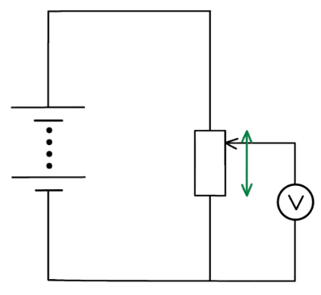
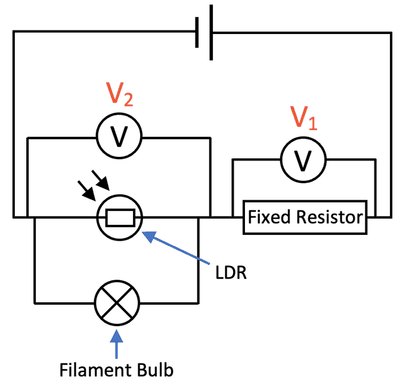
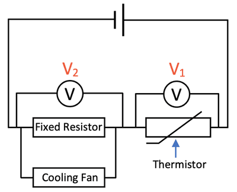
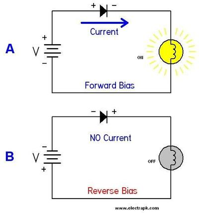

## Applications of electric circuits

**Increase in Resistance of a Conductor**

* In metals, current is carried by free electrons. As the temperature of the metal increases:
* The atoms vibrate more, making it harder for electrons to move.
* This results in an increase in resistance.

From Ohm's Law $V = IR$ , if resistance ($R$) increases while maintaining a constant current$( I )$, the potential difference ($V$) across the conductor also increases.

**Variable Potential Divider**

* In a thermistor, resistance decreases with increasing temperature.
* When it’s used in a potential divider circuit:
  * As temperature rises, the thermistor's resistance decreases.
  * This lowers the combined resistance of the two resistors, increasing the current if the supply voltage remains constant.
  * The potential difference across the fixed resistor increases relative to that across the thermistor.
* A variable resistor can also act as a potential divider by adjusting the position of the contact, changing the output potential difference. 

**Potential Divider**

For two resistors $R_1$ and $R_2$ in series with a supply voltage $( V )$:

* The total current $( I )$ is given by: $I = \frac{V}{R_1 + R_2}$

**Light-Dependent Resistor (LDR)**

* An LDR’s resistance decreases with increasing light intensity.
* In a circuit, as light intensity increases:
  * The LDR’s resistance decreases, allowing more current to flow.
  * This increase in current can light a lamp or cause other actions. 

**Thermistor**

* A thermistor's resistance decreases significantly with temperature increase.
* In a series circuit with a thermistor:
  * As temperature rises, its resistance drops, decreasing the potential difference across it.
  * This causes an increase in voltage across a series resistor, which can trigger a relay or alarm. 

**Relays**

* A relay allows a small current to control a larger current needed to operate an appliance.
* In a switching circuit:
  * If the switching circuit output is high, a small current flows through the relay, closing the mains switch.
  * This isolates the low voltage circuit from the high voltage mains supply.

**Light-Emitting Diode (LED)**

* An LED emits light when forward-biased (cathode connected to the negative terminal):
  * Reverse bias (anode connected to the negative terminal) does not emit light and can damage the LED if the reverse voltage exceeds 5 $V$.
  * A suitable resistor $R$ (e.g. 300 Ω on a 5 $V$ supply) is needed to limit the current.

**Semiconductor Diode**

* A diode allows current to pass in only one direction:
  * Forward-biased: current flows when the anode is connected to the positive terminal and the cathode to the negative terminal.
  * Reverse-biased: the diode does not conduct and has high resistance.
  

