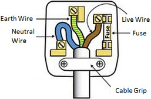

## Electrical safety

**Dangers of Electricity**

* Damaged Insulation: Exposes wires, increasing shock and fire risk.
* Overheated Cables: Can lead to fire.
* Damp Conditions: Increase shock severity due to reduced resistance.
* Excess Current: From overloaded plugs, extension leads, and multiple sockets.
* Electric Shock: Current flows from an electric circuit through a person's body to earth.
  * Dry Skin: Resistance \~10,000 Ω and current around 24 mA (it is safe).
  * Wet Skin: Resistance \~1,000 Ω and current \~240 mA (can be deadly).
  * Larger currents are more dangerous.
  * Longer exposure increases risk.

**Reducing Risk**

* Turn off power before repairs.
* Use earth pin and cord grips.
* Keep appliances dry and away from water.
* Avoid trailing cables and damage, especially with cutting tools.

**First Aid for Electric Shock**

* Switch off the power if the person is still in contact with the equipment.
* Call for medical assistance.

**Causes of fires**

* Flammable materials near hot appliances or wiring.
* Overheated wiring produces excessive current and can lead to fire.
* Preventive Measures:
  * Match fuse rating to appliance.
  * Do not overload sockets or use too many adapters.
  * Use thick wires for high-power appliances.

**House Circuits**

* Live and Neutral Wires: Both supply electricity and the neutral is earthed.
* Earth Wire: Provides safety by connecting metal cases to earth. 

**Switches and Fuses**

* Switches and fuses are in the live wire to prevent shocks.
* Fuse breaks the circuit if the current exceeds safe levels.

**Circuit Breakers**

* Electromagnetism breaks the circuit when current exceeds a preset level.
* Advantages: Faster operation and can be reset.

**Earthing**

* Prevents shock by providing a path for fault currents.
* Earth pin connects appliance metal cases to earth, preventing them from becoming live.

**Double Insulation**

* Appliances with two layers of insulation don’t need an earth wire.

