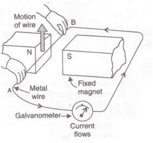
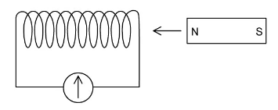
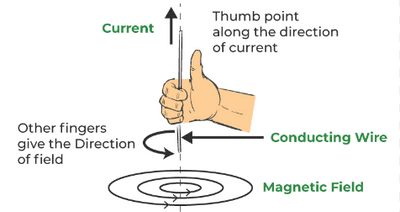
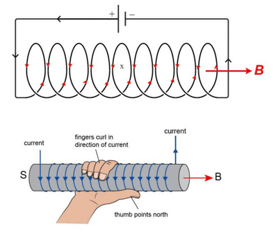

## Electromagnetic induction

* Process of generating electricity from a changing magnetic field.

**Electromagnetic Induction Experiments**

* **Straight Wire and U-shaped Magnet**
* Wire held still between magnet pole leads to no induced current.
* Moving wire vertically (up or down) between poles induces current because of changing magnetic flux (cutting magnetic field lines)
* Upward movement: current flows in one direction.
* Downward movement: current flows in the opposite direction.
* Deflection on meter is temporary and occurs only while wire is moving. 

**Bar Magnet and Coil (solenoid)**

* Inserting magnet into coil (solenoid) induces current in one direction.
  * A solenoid is a coil of wire wound in a helical shape that generates a magnetic field when an electric current passes through it.
* Removing magnet from solenoid induces current in the opposite direction.
* No current is induced when magnet is stationary inside solenoid.
* Current direction reverses with the direction of magnet movement.
* This also works if the solenoid is moved instead of the magnet. 

**Factors Affecting Induced** $e.m.f.$

* Faster movement of magnet or coil increases induced e.m.f.
* More turns in the coil increase the induced e.m.f.
* Stronger magnets increase the induced e.m.f.
* $e.m.f.$ is directly proportional to the rate at which the conductor cuts through magnetic field lines.

**Direction of Induced** $e.m.f.$ (Lenz’s Law)

* Induced $e.m.f.$ always opposes the change causing it.
* If a magnet approaches a coil, the induced current generates a magnetic field that opposes the motion.
* If a magnet is withdrawn, the coil’s induced current generates a field that attracts the magnet.

**Magnetic Fields**

* **Straight Wire:**
  * When current flows through a vertical wire, iron filings around it form circles.
  * Meaning that around a straight wire, there are circular magnetic field lines.
  * Field direction changes with current direction (upwards or downwards through the wire)
  * Use right-hand grip rule: direction of thumb (upwards or downwards) indicates magnetic field direction by the remaining fingers (clockwise or anti-clockwise). 
* **Solenoid**
  * A long cylindrical coil produces a magnetic field similar to a bar magnet.
  * End A behaves like the north pole, and end B behaves like the south pole.
  * Right-hand grip rule: grip solenoid in current direction, thumb points to the north pole.
  * Magnetic field inside the solenoid is stronger and denser compared to outside. 

**Variation of Magnetic Field Strength**

* Magnetic field strength decreases with distance from the wire.
* Field lines spread out as distance increases.
* Increasing current strengthens the magnetic field and lines become closer together.
* Reversing current direction reverses the direction of the magnetic field.

