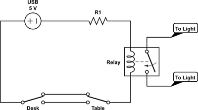
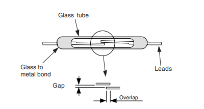
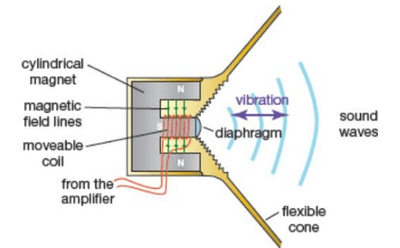
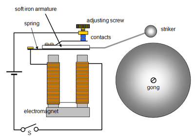

## Applications of electromagnetic effects

### **Relay**

* A relay is a switch that operates using an electromagnet.
* It allows one circuit to control another
* When current flows through the coil, it magnetizes the soft iron core.
* The magnetized core attracts the L-shaped iron armature.
* The armature rocks on its pivot and closes contacts in another circuit.  
* **Components**
  * Coil: Creates the magnetic field.
  * Soft Iron Core: Magnetized by the coil, attracts the armature.
  * L-shaped Iron Armature: Moves to close or open contacts.
  * Contacts: Switches the second circuit on or off.

### **Reed Switch**

* A reed switch uses magnetic fields to control a circuit.
* Operated by current flowing through a coil, which magnetizes reeds of magnetic material.
* Current flows: Reeds become magnetized, attract each other, and close the circuit.
* Current stops: Reeds lose magnetization, separate, and open the circuit.  

### **Loudspeaker**

* It converts electrical signals into sound waves.
* Varying currents pass through a coil placed in a magnetic field.
* Magnetic fields interact, causing the coil to vibrate.
* A paper cone attached to the coil moves with it.
* Vibrations create sound waves in the surrounding air.
* **Components**
  * Coil: Receives electrical signals and vibrates.
  * Magnet: Provides the magnetic field for interaction.
  * Paper Cone: Moves with the coil to produce sound.  

### **Electric Bell**

* A device that produces sound by ringing is an electric bell
* Pressing the bell push completes the circuit.
* Current flows through electromagnet coils, magnetizing them.
* Electromagnet attracts a soft iron bar (armature), causing the hammer to hit the gong.
* The circuit breaks at contact screw point
* Electromagnet loses magnetism, armature returns to its original position.
* The springy metal strip reconnects the circuit, and the cycle repeats as long as the bell push is pressed.  

