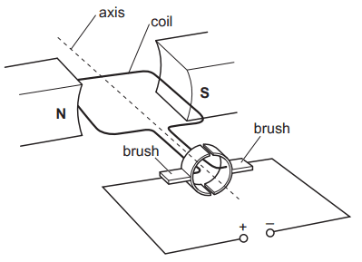
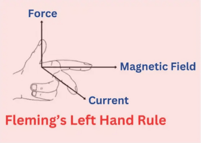
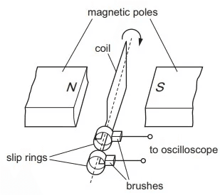
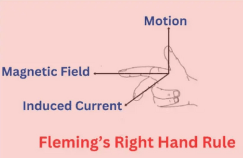

## Motors and generators

### Simple $d.c.$ Electric Motor

* **Component**s
  * **Rectangular coil**: Fixed up on an axle that can rotate.
  * **C-shaped magnet**: Provides the magnetic field.
  * **Split-ring commutator**: A copper ring split into two halves, connected to the ends of the coil. It rotates with the coil.
* **Brushes**: Carbon blocks pressed against the commutator to supply current continuously.    **Operation**
* When direct current ($d.c.)$ flows through the coil, a force acts on the coil due to the interaction with the magnetic field.
* This force creates a turning effect, causing the coil to rotate.
* The split-ring commutator reverses the direction of current in the coil as it rotates, making sure there is continuous rotation by maintaining the direction of force.

> Fleming’s Left Hand Rule is used for the $d.c.$ motor   

### The $a.c$ Generator

**Components**

* **Rectangular coil**: Positioned between the poles of a C-shaped magnet.
* **Slip rings**: Connected to the ends of the coil, rotate with the coil.
* **Carbon brushes**: Press against the slip rings to conduct current.    

**Operation**

* As the coil rotates in the magnetic field, it cuts through the field lines, inducing an electromotive force ($e.m.f.$)
* The $e.m.f.$ varies as the coil moves
* Vertical Position: No $e.m.f.$ as the coil cuts the least number of field lines.
* Horizontal Position: Maximum $e.m.f.$ as the coil cuts the most field lines.
* The direction of $e.m.f.$ reverses as the coil continues to rotate, producing alternating current ($a.c.$) in the circuit.
* The frequency of the $a.c$. is determined by the rotation speed of the coil. For example, a coil rotating twice per second generates an $a.c$. with a frequency of 2 $Hz.$

> Fleming’s Right Hand Rule is used for the $a.c.$ generator.    

