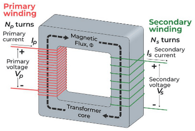

## Transformers

* The transformer changes alternating voltage to different values.
* Consists of primary and secondary coils on a soft iron core.
* Coils can be wound on top of each other or separate limbs.

**Mutual Induction**

* This occurs when current changes in one coil, inducing a voltage in a neighboring coil.
* Magnetic field lines from the primary cut through the secondary coil, inducing voltage.
* Induced voltage increases with a soft iron rod or complete iron ring core due to increased magnetic field lines.  

**Transformer Equation**

* The alternating voltage applied to the primary induces an alternating voltage in the secondary.
* Relationship given by $\frac{V_p}{V_s}$ = $\frac{N_p}{N_s}$
* $V_p$ and $V_s$ the primary and secondary voltages.
* $N_p$ and $N_s$ are the primary and secondary turns.
* Step-up transformer: More turns are on secondary $(N_s > N_p)$.
* Step-down transformer: fewer turns on secondary, ($N_s < N_p$).

**Worked Example**

* A transformer steps down the mains supply from 230V to 10V.
* Turns ratio: $\frac{N_p}{N_s}$ = $\frac{230V}{10V}$ = $\frac{23}{1}$
* If the secondary has 80 turns, the primary has $80 \times 23= 182$ turns.

**Energy Losses**

* If $V$ s stepped up, current $I$ is stepped down proportionally.
* Ideal transformer (100% efficient): $I_p V_p$ = $I_s V_s$
* $I_p$ and $I_s$ are primary and secondary currents.
* If $V$ is doubled, $I$ is halved.