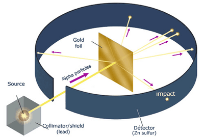
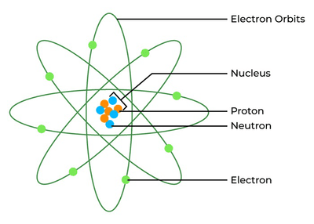
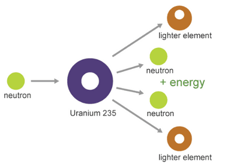

# Nuclear Physics

## Nuclear model of the atom

**Current atomic model**

* Electrons orbit a positively charged nucleus.
* Mostly empty space between the orbits and the nucleus.

**Scattering experiments by Ernest Rutherford**

* α-particles directed at thin gold foil.
* Observations of α-particles:  

|Observation|Description|Proof of atomic model|
|:---|:---|:---|
|Most α-particles|Passed through the gold foil without deflection.|Atom is mostly empty space.|
|Some α-particles|Deflected at small angles.|Presence of a dense, positively charged nucleus which repels the α-particles|
|Approximately 1 in 8000 α-particles|Deflected back towards the source at large angles.|Nucleus is very small and dense compared to the rest of the atom.|

**Rutherford’s nuclear model**

* Positive charge and most mass are concentrated in a small, dense nucleus.
* Electrons orbit the nucleus at a large distance away.
* Nucleus and electrons occupy about one-million-millionth of the atom’s volume.

**The nucleus**

* The nucleus of an atom consists of protons and neutrons.
* Three basic particles in an atom include protons, neutrons, and electrons.
  * Proton = a hydrogen atom minus an electron charge $+1$, mass about 2000 times that of an electron.
  * Neutron: Uncharged and with a mass almost equal to that of a proton.
  * Relative charges: Proton = +1 and neutron = 0 while electron = -1.
  * Protons and neutrons are located in the nucleus and are together called nucleons.  

|Particle|Relative Mass|Relative Charge|Location|
|:---|:---|:---|:---|
|Proton|1|+1|In nucleus|
|Neutron|1|0|In nucleus|
|Electron|$\frac{1}{1840}$|-1|Outside nucleus|

* In a neutral atom the number of protons equals the number of electrons.
* Atomic number ($Z$): Number of protons in the nucleus (it also equals the number of electrons).
* Mass number ($A)$: Total number of nucleons (protons + neutrons) in the nucleus.
* Relationship: Number of neutrons = $A - Z$.
* Nuclide notation: Atom $X$ is represented as ${}^{A}_{Z}X$, where $A$ is the nucleon number and $Z$ is the proton number.
* Relative charge: Product of proton number ($Z$) and the charge of a proton.
* Relative mass: Total mass of neutrons and protons; approximately $A$ times the mass of a proton.

**Isotopes**

* Forms of the same element with the same number of protons but different number of neutrons.
* Example: Chlorine has isotopes ${}^{35}*{17}Cl$ and ${}^{37}*Cl$ while Hydrogen has isotopes ${}^{1}*{1}H$, deuterium  ${}^{2}*H$, and tritium  ${}^{3}_{1}H.$

> Isotopes have identical chemical properties but different physical properties.

**Nuclides**

* Radioactive isotopes are called radioisotopes or radionuclides and have unstable nuclei.

**Nuclear Energy**

* Einstein’s equation: $E = mc^2$, where $E$ is energy, $m$ is mass, and $c$ is the speed of light.
* Mass loss in nuclear reactions results in energy release.
* Nuclear reactions involve large energy changes compared to other physical and chemical changes.

**Nuclear fission**

* Uranium-235 is an isotope that undergoes fission when struck by neutrons.
* Fission breaks the nucleus into smaller radioactive nuclei, releasing additional neutrons and energy.
* Mass loss is converted into kinetic energy of fission products.
* Neutrons from fission can trigger further fission reactions.

**Nuclear fusion**

* Nuclear Fusion is the joining of light nuclei to form a heavy nucleus and releases energy

**Nuclear Reactor**

* Reactors use controlled chain reactions to produce energy.
* Control rods absorb neutrons to regulate the reaction.
* Graphite moderates neutrons to slow down fission.  