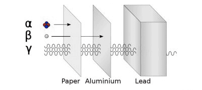
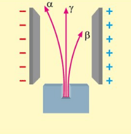
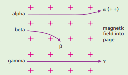

## Types of Radioactivity

**Natural Background Radiation**

Radiation sources include:

* Cosmic rays (high-energy particles from the Sun) are mostly absorbed by the atmosphere, but some reach the Earth's surface.
* Radon gas present in the air.
* Granite rocks in homes, particularly in Scotland, emit radioactive radon gas that can accumulate in poorly ventilated areas.
* Radioactive potassium-40 is present in food and absorbed by our bodies.
* Various radioisotopes are used in medical procedures.
* Radiation from nuclear power stations and fallout from nuclear bomb testing

**Ionising Effect of Radiation**

* The ability of radiation to make atoms lose or gain electrons and become charged.

* A charged electroscope discharges when a lighted match or a radium source is brought near the cap.

$\text{Electroscope Discharge:}$ $\text{Neutral Atom}$ $\rightarrow$ $\text{Positive Ion}$ + $\text{Electron}$

* A lighted match knocks electrons out of air molecules, creating positive ions.
* Radiation causes ionisation by neutralising the charge on the electroscope.

$\text{Ionisation:}$ $\text{Neutral Atom}$ $+$ $\text{Electron}$ $\rightarrow$ $\text{Negative Ion}$

**Geiger–Müller (GM) Tube**

* The ionising effect of radiation is used to detect radiation.
* Radiation entering a GM tube creates argon ions and electrons, which then cause more ionisation.

**Alpha, Beta, and Gamma Radiation**

* **Alpha Particles** $(\alpha)$
  * The nucleus with two protons and two neutrons 
  * Stopped by thick paper; range in air is a few centimetres.
  * The high ionising power of alpha particles is due to their increased mass (compared to gamma and beta), so it's more likely to ionise an atom
  * Deflected by electric and magnetic fields.
  * Represented as helium ions with a double positive charge.

* **Beta Particles (**$\beta$**)**
  * fast-moving electron
  * Stopped by a few millimetres of aluminium; range in air is several metres.
  * Lower ionising power than alpha particles.
  * Deflected by electric and magnetic fields.
  * Streams of high-energy electrons.

* **Gamma Radiation (**$\gamma$**)**
  * Electromagnetic radiation having high frequency 
  * Most penetrating
  * Stopped only by many centimetres of lead.
  * Least ionising power.
  * Not deflected by electric and magnetic fields.
  * Electromagnetic radiation.

 

| Type of Radiation | Mass | Charge | Penetrating Power | Ionising Power |
|----|----|----|----|----|
| Alpha (α) | High (Helium nucleus) | +$2$ | Low (stopped by paper) | High |
| Beta (β) | Low (electron) | -$1$ | Moderate (stopped by few mm of aluminum) | Moderate |
| Gamma ($\gamma$) | None (electromagnetic wave) | 0 | High (stopped by several $cm$ of lead) | Low |

**Particle Tracks**

* Cloud chambers reveal the tracks of particles based on the ionisation they produce.
  * **Alpha Particles:** Straight, thick tracks.
  * **Beta Particles:** Thin, straight or twisted tracks.
  * **Gamma Rays:** Eject electrons which then produce tracks similar to $\beta$ particles.

**Electric deflection**

* The positive alpha particles are heavier and slowly deflect towards the negative plate.
* The negative beta particles are lighter and quickly deflect towards the positive plate.
* The neutral electromagnetic gamma radiation remains undeflected.

 **Magnetic deflection**

* Alpha particles follow the rule of positive conventional current.
* Fleming’s left-hand rule is used with the middle finger pointing in the direction of alpha particles.
* Beta particles are shown in the direction opposite to the middle finger, as they represent electron flow, which is the opposite of conventional current.
* Gamma radiation is not deflected.  

