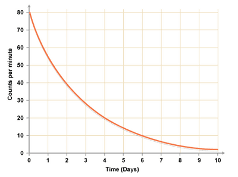

## Radioactive decay and half-life

**Radioactive Decay**

* Radioactive decay is the emission of an α-particle or a β-particle from an unstable nucleus.
* This changes the nucleus into that of a different element until a stable element is formed.
* These changes are spontaneous and random

**Alpha Decay (α-decay)**

* An α-particle is a helium nucleus with two protons and two neutrons.
* When an atom undergoes α-decay, its nucleon number decreases by 4 and its proton number decreases by 2.
* Example: When radium ($^{226}_{88}\text{Ra}$) emits and alpha particle, it becomes radon $(^{222}_{86}\text{Rn})$.
* The equation for this decay is: $^{226}_{88}\text{Ra} \rightarrow ^{222}_{86}\text{Rn} + ^{4}_{2}\text{He}$

**Beta Decay (β-decay)**

* In β-decay, a neutron changes into a proton and an electron.
* The proton remains in the nucleus, while the electron is emitted as a β-particle.
* The nucleon number stays the same, but the proton number increases by 1.
* Example: Radioactive carbon  $^{14}_{6}\text{C}$  decays into nitrogen ($^{14}_{7}\text{N}$) by β-emission.
* The equation for this decay is: $^{14}_{6}\text{C} \rightarrow ^{14}_{7}\text{N} + ^{0}_{-1}\text{e}$

**Gamma Emission (γ-emission)**

* After α- or β-decay, some nuclei are left in an excited or energetic state.
* Rearrangement of protons and neutrons releases energy in the form of γ-emissions.
* γ-emissions are high-energy electromagnetic waves with no mass or charge.

**Nuclear Stability**

* Stability of a nucleus depends on the number of protons ($Z$) and neutrons ($N$).
* Stable nuclides fall within a specific stability level called the stability line.
* For light nuclides, $N = Z$.
* For heavier nuclides, $N > Z$.
* Unstable nuclides decay to move towards the stability line.
* Nuclides above the stability line decay by β-emission to decrease the $\frac{N}{Z}$ ratio.
* Nuclides below the stability line decay by beta emission (β+) to increase the $\frac{N}{Z}$ ratio.
* Nuclei with more than 82 protons usually decay by α-emission.

**Half-Life**

* The half-life of an isotope is the time taken for half the nuclei in a sample to decay.
* It is a measure of the rate at which a radioactive substance decays.
* Each isotope has its own special half-life.
* It can be from fractions of a second to millions of years.
* A decay curve plots the activity of a sample over time, showing the exponential decrease in activity.
* The activity decreases by half in each half-life period from the previous half-life period.
* Example: If a sample's activity is 80 decays per second, it will reduce to 40 in one half-life, then to 20 in the next, and so on.
* Radioactive decay is random and unpredictable; the exact time when a particular nucleus will decay cannot be determined.
* The overall decay rate of a sample follows a predictable pattern, called its half-life. 

