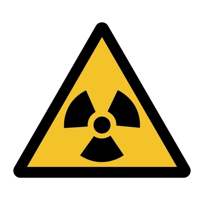

## Safety precautions

**Dangers of Nuclear Radiation**

* Exposure to small doses of radiation is not damaging, but large doses are harmful to health.
* Nuclear radiation's ionising effect damages cells and tissues, it can lead to gene mutations.
* Damage can cause cell death and cancers.
* α-particles are less dangerous unless the source is ingested or inhaled.
* β- and γ-radiation can cause radiation burns, eye cataracts, and cancer.
* Radiation hazard signs warn of the presence of radioactive material.  

**Safety Precautions**

* Minimize exposure time to radiation.
* Keep a large distance between the radiation source and individuals.
* Use shielding materials that absorb radiation to protect people.
* In industry, sources are handled with long tongs and transported in thick lead containers.
* Workers are protected by lead and concrete walls and wear radiation dose badges.
* Radiation dose badges track the amount of radiation exposure over a period, typically one month.
* The badge has windows that allow different types of radiation to expose photographic film, indicating exposure levels when developed.