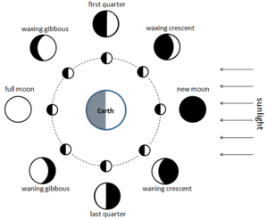
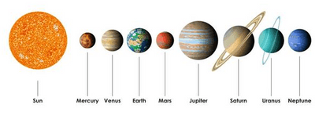
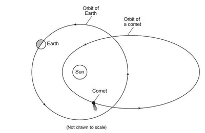
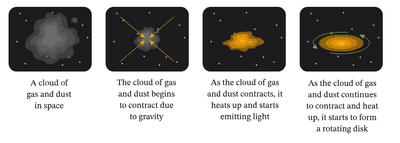

# Space Physics

## The Earth and the solar system

**Motion of the Earth**

* The Earth spins on its axis, causing day and night.
* One complete rotation takes 24 hours.
* Day is for the half of the Earth facing the Sun and night for the half facing away.

**Rising and setting of the Sun**

* Earth's rotation causes the Sun to appear to move east to west daily.
* Rises exactly in the east and sets exactly in the west at equinoxes.
* In northern hemisphere summer, the Sun rises north of east and sets north of west.
* In winter, rises and sets south of these points.

**The seasons**

* Caused by Earth's motion around the Sun (365 days) and tilt of its axis.

**Motion of the Moon**

* Moon is a satellite of Earth, orbiting approximately every month
* Average distance from Earth is about 400,000 $km$.
* Revolves on its axis, always showing the same side to Earth
* Reflects sunlight, has no atmosphere, weaker gravitational field (one-sixth of Earth)

**Phases of the Moon**

* Moon's appearance changes during its monthly orbit
* New Moon: Moon between Sun and Earth, unlit side faces Earth
* Crescent appears and increases until the first quarter (half of the Moon visible)
* Full Moon: Moon opposite Earth from the Sun, fully visible

Waning (where the moon's illumination decreases) phases follow, leading to the last quarter and old crescent       

**Orbital speed**

* Average orbital speed: $u$ = $\frac{2\pi r}{T}$
  * $r$ is the average radius of the orbit.
  * $T$ is the orbital period (time for one orbit)
  * The Moon travels in a circular path around the Earth
  * Distance traveled in one orbit is the circumference of the circle, $2\pi{r}$
  * Time taken for one orbit is  $T$
  * Speed is distance divided by time, so orbital speed is $\frac{2\pi r}{T}$

**The Solar System**

* It contains:
  * The sun as a star
  * Eight planets in elliptical orbits (slightly oval orbits)
  * Dwarf planets and asteroids orbiting the Sun
  * Moons orbiting many planets
  * Smaller bodies like comets and natural satellites

**Inner Planets**

* Mercury, Venus, Earth, Mars
* Small, similar size
* Solid and rocky with layered structures
* High density
* Formed close to the Sun where it was too hot for gases to condense, allowing only metals and silicates to form solid bodies
* In the early Solar System, the Sun's heat caused lighter gases to evaporate, leaving only heavy elements like iron and silicon to form solid planets.

**Outer Planets**

* Jupiter, Saturn, Uranus, Neptune
* Much larger and colder
* Mainly consist of gases, low density
* Many moons and rings of icy materials
* Formed in cooler regions where gases could condense, capturing even the lightest elements
* In the outer regions of the Solar System, lower temperatures allowed gases like hydrogen and helium to remain in solid or liquid forms, leading to the formation of gas giants with thick atmospheres.      

**Asteroids**

* Pieces of rock of various sizes, mostly between Mars and Jupiter
* Orbit around the Sun
* Similar density to inner planets
* Burn up in Earth's atmosphere as meteors

**Comets**

* Dust embedded in ice made from water and methane
* Orbits the Sun in highly elliptical paths
* Develop a bright long tail when approaching the Sun due to radiation pressure      

**Elliptical Orbits**

* Planets, dwarf planets, and comets orbit the Sun in an ellipse
* Sun is at one focus of the ellipse, not the center
* Comets have highly elliptical orbits, while planets' orbits are more circular

**Origin of the Solar System**

* Formed from gravitational attraction pulling together clouds of hydrogen gas and dust (nebulae)
* Solar System formed about 4500 million years ago
* Planets formed from the disc of matter left over from the nebula that formed the Sun
* Inner planets formed from materials with high melting temperatures like metals and silicates
* Outer planets formed from light molecules that existed in solid icy forms, growing large enough to capture hydrogen      

**Travel Times**

* Distance from the Sun to Earth: approximately 150 million $km$ ($1.5 × 10^8 $ $km$)
* Speed of light: 300,000 kilometers per second ($km/s$)

Using the formula for time:

$\text{Time} = \frac{\text{Distance}}{\text{Speed}}$

Substitute the values:

$\text{Time} = \frac{1.5 \times 10^{8}}{300,000}$

Calculate the time:

$\text{Time} \approx \frac{1.5 \times 10^{8}}{300,000} \text{ seconds}$ $\approx 500 \text{ seconds}$

Convert the time from seconds to minutes:

$\text{Time} \approx \frac{500}{60}$ $\approx 8.33 \text{ minutes}$

* It takes light from the sun around 8 minutes to reach the Earth.

