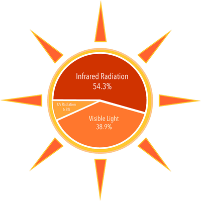

## The sun

*  Medium-sized star composed mainly of hydrogen and helium.
*  Emits energy in the infrared, visible, and ultraviolet regions of the electromagnetic spectrum.

**Source of Energy**

* Energy from nuclear reactions in the core.
* Hydrogen undergoes nuclear fusion to form helium, releasing energy.
* Energy from the core heats outer layers, causing them to glow and emit radiation. 

**Nuclear Reactions in Stars**

Stars like the Sun are powered by nuclear fusion.

**Core conditions**

* Hot and dense enough for hydrogen to fuse into helium.
* Fusion process releases energy, maintaining high core temperatures.

* Some core energy moves to outer layers, which emit electromagnetic radiation.

**Light-years**

* Distance light travels in a vacuum in one year.
* 1 light-year = $9.5 × 10¹²$ $km$ = $9.5 × 10¹⁵$ $m$

**Galaxies**

 Large collections of stars, gas, and dust.

