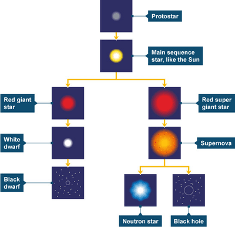

## Origin and life cycle of stars

**Formation**

* Interstellar clouds of dust and gas collapse under gravitational attraction.
* A protostar forms as mass increases and core temperature rises.
* Hydrogen fuses into helium when the core is hot enough, resulting in a star.

**Star Types**

* Large mass: Blue or white stars.
* Smaller mass: Yellow or red dwarfs (e.g., the Sun).

**Life Cycle of Stars**

**Stable Phase**

* Forces of gravity inward balance with thermal pressure outward.
* Stable phase lasts up to 10 billion years.
* Hydrogen converts to helium in the core.

**Red Giant/Red Supergiant**

* As hydrogen depletes, the star becomes unstable.
* Core collapses; outer layers expand and cool.
* Star turns into a red giant (or red supergiant if massive).
* Helium fuses into carbon in the core.

**Low Mass Stars**

* **End Stage**
  * Core collapses into a white dwarf after all helium is used.
  * Outer layers expelled, forming a planetary nebula.
  * White dwarf cools into a black dwarf over about a billion years.

**High Mass Stars (more than 8 times the Sun’s mass)**

* **End Stage**
  * Use hydrogen rapidly, with a shorter stable phase (about 100 million years).
  * After helium fusion, core collapses into a red supergiant.
  * Fusion of carbon into heavier elements occurs until iron forms.
  * Supernova explosion releases energy and heavy elements into space.
  * **Neutron Star**: Dense core, may act as a pulsar.
  * **Black Hole**: Extremely dense core with gravitational field so strong that even light cannot escape; identified by X-ray radiation from nearby material. 

