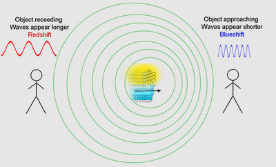

## The universe

**Milky Way**

* Approximately 100,000 light-years in diameter.
* Contains around 800 billion or more stars.
* A spiral galaxy with a central bulge and spiral arms.

**Redshift**

* The phenomenon where light from distant galaxies shifts towards the red end of the spectrum (longer wavelength).
* Light emitted from stars in distant galaxies appears redder compared to light from closer galaxies.

**Doppler Effect**

* Occurs when a source of waves (e.g., sound or light) moves relative to an observer.
* Approaching Source: Waves are compressed, resulting in a higher frequency and pitch (blue shift for light).
* Receding Source: Waves are stretched, resulting in a lower frequency and pitch (red shift for light).   

**Speed of Recession**

* The speed at which distant galaxies are moving away can be calculated from the amount of redshift observed.
* Some of the most distant galaxies are receding at speeds up to one-third the speed of light.
* The observed redshift supports the idea that the Universe is expanding, which is consistent with the Big Bang theory.

**Big Bang Theory**

* Initial State: Proposes that the Universe began from an extremely hot and dense state around 14 billion years ago.
* Expansion: The Universe has been expanding ever since the Big Bang.

**Microwave Background Radiation**

* This radiation is a remnant from the Big Bang and fills the entire Universe.
* The radiation has been redshifted into the microwave region due to the expansion of the Universe.
* Provides strong evidence for the Big Bang theory and insights into the early Universe.

**Age of the Universe**

* Hubble’s Law: The relationship between the speed of recession ($v$) and the distance ($d$) of galaxies is given by: $v = H_0 \times d$
* Hubble Constant ($H_0$): $H_0 = \frac{v}{d}$
* $H_0$ measures the rate of the Universe's expansion. A higher value indicates a faster rate of expansion.
* $H_0$ is estimated to be approximately $2.2 \times 10^{-18} \text{ s}^{-1}$
* Age Estimation: The age of the Universe is approximately: $\text{Age of the Universe} \approx \frac{1}{H_0}$

**Detailed Calculation**

* $\text{Age of the Universe} \approx \frac{1}{2.2 \times 10^{-18} \text{ s}^{-1}} \approx 4.5 \times 10^{17} \text{ s}$
* $\text{Age of the Universe} \approx \frac{4.5 \times 10^{17} \text{ s}}{3.2 \times 10^7 \text{ s/year}} \approx 1.4 \times 10^{10} \text{ years} \approx 14 \text{ billion years}$

