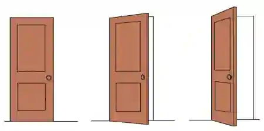

# Visual Perception

## Key Concepts

### Sensation

* Sensation is the physical detection of stimuli by the sense organs.

* Sensory receptors detect information from the environment and convert it into nerve impulses that are sent to the brain.

**Example:**

* Light enters the eyes.

* Sound waves enter the ears.

* Pressure is detected by the skin.

### Perception

Perception is the **interpretation and conscious experience of sensory information**.

The brain organises and gives meaning to the information received through the senses, allowing us to recognise objects, people and events.

**Example:**

Seeing light reflected from an object (sensation) is interpreted by the brain as recognising a car (perception).

**Key difference**

Sensation = detecting information.

Perception = making sense of that information.

### The Five Senses

#|
||

Sense

|

Detects

||
||

Sight

|

Light

||
||

Hearing

|

Sound waves

||
||

Touch

|

Pressure, temperature and pain

||
||

Taste

|

Chemicals dissolved in saliva

||
||

Smell

|

Chemicals in the air

||
|#

### The Occipital Lobe

The occipital lobe is located at the back of the brain and is responsible for processing visual information.

It receives signals from the eyes and helps identify features such as:

* Colour

* Shape

* Movement

* Depth

Without the occipital lobe functioning normally, visual information cannot be interpreted correctly.

### **Diagram of Brain Showing the Occipital Lobe**

### Visual Constancies

* Visual constancies allow us to perceive objects as remaining the **same**, even when the image reaching the retina changes.

* The brain combines sensory information with previous experience so that objects are recognised consistently despite changes in viewing conditions.

* Without visual constancies, objects would appear to constantly change whenever we moved.

### Shape Constancy

* Objects are perceived as having the same shape even when viewed from different angles.

**Example:**

A door is recognised as rectangular whether it is open or closed.

### Size Constancy

* Objects are perceived as remaining the same size even when their distance changes.

* Although a person far away produces a smaller retinal image, we know they have not actually become smaller.

### Colour Constancy

* Objects are perceived as having the same colour under different lighting conditions.

* The brain adjusts for changes in lighting so that colours remain stable.

**Example:**

A white shirt still appears white in sunlight or indoors.

**Shape Constancy: Perceiving a Door from Different Angles**

### Depth Cues

* Depth cues help us judge how far away objects are and perceive the world in three dimensions.

* These cues allow us to estimate distance by using information available in the visual environment.

### Relative Brightness

* Brighter objects are usually perceived as being **closer**, while darker objects appear further away.

**Example:**

A brightly lit tree appears nearer than one hidden in shadow.

### Texture Gradient

* Objects nearby have clear, detailed textures.

* As objects become further away, their textures appear smoother and less detailed.

**Example:**

Individual blades of grass can be seen nearby, while distant grass looks smooth.

### Relative Size

* When two objects are known to be the same actual size, the one appearing smaller is perceived as being further away.

**Example:**

Two people of similar height appear different sizes because one is standing further away.

### Superimposition

* If one object partly blocks another, the blocking object is perceived as being closer.

**Example:**

A tree covering part of a house is judged to be nearer than the house.

### Height in Plane

* Objects positioned higher in the visual field are generally perceived as being further away.

**Example:**

Trees near the horizon appear more distant than trees lower in the picture.

### Gestalt Principles of Perception

The **Gestalt psychologists** proposed that people perceive **whole objects before individual parts**. The brain naturally organises separate visual elements into meaningful patterns.

### Figure-Ground

The brain separates an object (**figure**) from its background (**ground**).

The same image can sometimes be interpreted in two different ways.

**Example:**

Rubin's Vase can be be seen as either:

* A vase

* Two faces

### Similarity

Objects that look alike are perceived as belonging together.

Similarity may be based on:

* Colour

* Shape

* Size

**Example:**

Blue circles are grouped together even if mixed with red circles.

### Proximity

* Objects that are close together are perceived as belonging to the same group.

**Example:**

Dots placed close together appear to form rows or columns.

### Closure

* The brain fills in missing information to perceive complete objects.

**Example:**

A broken circle is still seen as a complete circle.

### Continuity

* The brain prefers smooth, continuous lines rather than sudden changes.

**Example:**

Crossing lines are perceived as two continuous lines rather than several separate pieces.

### Application of Knowledge

* **Scenario:** A driver easily recognises a stop sign from different angles while approaching an intersection.

  * **Explanation:** Shape constancy allows the stop sign to be recognised as the same shape despite changes in viewing angle.

* **Scenario:** A hiker judges one mountain to be further away because it appears smoother and less detailed.

  * **Explanation:** Texture gradient acts as a depth cue, with less detailed textures indicating greater distance.

* **Scenario:** A child immediately groups children wearing the same football uniform together.

  * **Explanation:** The Gestalt principle of **similarity** causes people with similar appearances to be perceived as belonging to the same group.

* **Scenario:** A student recognises a friend's white shirt both outside in bright sunlight and inside a dim classroom.

  * **Explanation:** Colour constancy allows the shirt to be perceived as the same colour despite different lighting conditions.