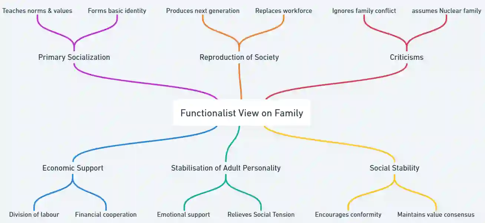

## **Functionalist View**

* Functionalists argue that societies require certain essential functions to survive, and social institutions exist to perform these functions.

* The family is seen as the foundation of society because it carries out vital functions that maintain social order and stability

* Most functionalists agree on a core set of functions performed by the family:

  * **++Reproduction++**: Societies must produce new generations of children to survive

  * **++Socialisation++**: The family carries out primary socialisation

    * Children learn society’s norms, values, and culture

  * **++Social Control++**: The family provides social control

    * Children’s behaviour is regulated so they conform to social norms

    * Parents use rewards and punishments to encourage acceptable behaviour

  * **++Roles for Family Members++**: The family organises roles through a gendered division of labour

    * Different family members perform specific roles based on natural differences between men and women

    * Men perform the instrumental role as breadwinners

    * Women perform the expressive role, providing care and emotional support

    * This division is seen as functional for both social stability and individual well-being

  * **++Care of Children, the Elderly and the Sick++**: The family meets members’ physical and emotional needs

    * Provides food, shelter, care, and emotional support

    * Family members take responsibility for each other

  * **++Status++**: Families provide status for children by involving them in many relationships

  * **++Regulation of Sexual Behaviour++**: Families ensure children are born to people in a socially approved sexual relationship.

Some of these functions are for individuals, some for society and some for both.

### The Loss of Functions Debate and how Family Functions have changed over Time

**Industrialisation, Urbanisation, and the Rise of the Nuclear Family**

* Industrialisation and urbanisation made the nuclear family dominant in Europe and North America by the 20th century

  * Extended families fitted pre-industrial, family-based subsistence farming

  * Nuclear families fitted mobile wage labour and urban living

    * Nuclear units were easier to move for work in growing towns and cities

* The expansion of large organisations and the state shifted some family functions to institutions

  * Schools, hospitals, transport and welfare services grew

  * State support, such as pensions and welfare, reduced the family’s role in education, healthcare, and social security

**Functionalist Perspective on Family Change**

* Talcott Parsons argued that the nuclear family is well-suited to modern industrial societies

  * In pre-industrial societies, families met many needs: care for the sick and elderly, financial support, and skills training

  * Large extended families increased the likelihood of help being available

* Many traditional family functions have shifted to other institutions

  * Welfare, healthcare, and education are now largely provided by the state and other organisations

* Nuclear families support labour mobility

  * Nuclear families are more geographically mobile than extended families

* Functionalists argue that families change to meet the needs of society

  * In pre-industrial societies, the extended family was more functional due to limited state education and healthcare

  * In industrial societies, the nuclear family became more functional as industrialisation required a mobile workforce

* From a functionalist view, there is no single fixed family type

  * Each society develops the family form that best fits its needs at that time

#|
||

**Function**

|

Traditional Society: Extended Family

|

Modern Industrial Society: Nuclear Family

||
||

**Care of young kids**

|

parents with help of extended family

|

parents and childcare professionals

||
||

**Care of the elderly**

|

extended family

|

pensions, retirement homes, social services

||
||

**Care of the sick**

|

extended family

|

health services, doctors

||
||

**Help with work**

|

family and neighbours

|

not needed anymore

||
||

**Education**

|

family and community

|

schools and media

||
||

**Financial support**

|

extended family

|

welfare state, bank loans

||
|#

* Parsons argued that family functions have declined

  * However, two remain unique to the family:

    * Primary socialisation

    * Stabilisation of adult personalities

      * Providing adults with a role and responsibility

* Therefore, Parsons saw the nuclear family as still essential for society and individuals

### Warm Bath Theory

* Industrialisation and urbanisation led to long, stressful and dangerous work in factories and mines

* Male workers needed to recover so they could keep returning to work and earning wages

  * Women became housewives who cared for the home and husband

  * Domestic tasks and emotional support helped men rest and relax

  * Like a warm bath, the family relaxes and refreshes workers so they can return to work

### Importance of the Nuclear Family

* Functionalists argue that Parsons’ key functions are best performed in the nuclear family

  * Primary socialisation of children

  * Stabilisation of adult personalities

* The nuclear family also meets the emotional and economic needs of its members

  * Mothers are responsible for emotional care and home-based needs

  * Fathers are responsible for economic and material support

* However, other sociologists argue that these functions are not unique to the nuclear family

  * In the past, primary socialisation was often carried out by extended families and communities

  * In modern industrial societies, schools and other institutions now perform some socialisation and childcare functions

**Critiques of the nuclear family**

* The family may fulfil wider societal functions but can be dysfunctional for some individuals

* Edmund Leach argued that the modern nuclear family can be dysfunctional

  * The ‘cereal packet’ image of the family shows a happy couple with healthy children

  * This ideal is promoted everywhere in advertising and the media

  * Families that cannot meet this ideal face pressure and tension

