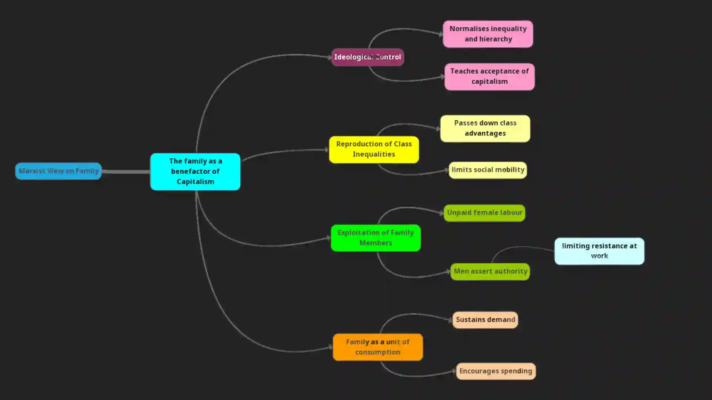

## **Marxist Views**

### How the Family Benefits Capitalism

* Marxists agree with functionalists that families perform functions for society, but disagree on what these are

* For Marxists, the family functions primarily for the benefit of capitalist society, which contributes to the continuation of the economic system

* Friedrich Engels, who worked with K. Marx, argued that the family can only be understood in terms of its economic role

  * Before capitalism and private property, families were looser, with no strict monogamy

  * Capitalism required men to know who their children were to pass on wealth, which led to the development of monogamous families

According to Marx, the following family functions benefit capitalism:

* Each new generation is socialised into believing the capitalist system is fair, and failure is their own fault

* The family raises the next generation of workers, profiting capitalists

* The family is the main unit of consumption: families support the capitalist system by buying and consuming goods

* Men oppressed at work may take out their anger and frustration on wives and children at home

* Women care for the sick and elderly, allowing the ruling class to avoid responsibility for health and social care

### Exploitation of Family Members

* Capitalism operates through the exploitation of the working proletariat by the bourgeoisie

* The family helps maintain this unequal system

  * Workers powerless at work may assert authority at home, controlling wives and children

  * This gives them a sense of power and control, reducing the likelihood of rebelling against employers

* Functionalist Counterargument: the family can be a safe haven where men relax and recover (warm bath theory)

### Reproduction of Class Inequalities

* Families reproduce the labour force by having children, supplying the next generation of workers for the bourgeoisie

  * Children observe their parents’ lives and accept that their lives will be similar

* This socialisation teaches children that they have little power to change their situation

### Family as a Unit of Consumption

* Before industrialisation and urbanisation, families were **units of production,** and their livelihood depended on what they produced

  * Gendered division of labour existed, but the family worked together to support each other

* Industrialisation and urbanisation changed this

  * Men and boys increasingly worked outside the home in mines, factories, and other jobs

  * Families earned wages instead of producing their own goods

  * As living standards improved, families bought items for the home (electric goods, furniture, cars)

* Marxist view: families became **units of consumption**

  * Workers are pressured by advertising to buy more than they need, increasing profits for the bourgeoisie

### Family and Ideological Control

* Families help legitimise and continue capitalism through ideology

  * Children absorb capitalist ideas that justify the social hierarchy and teach them their “place” in society

  * They learn to desire and want to buy more goods

* Some families may resist this influence, but these efforts are usually outweighed by other influences

  * Media, peers, and other socialisation agencies reinforce capitalist ideas

#|
||

Function

|

How it Works

|

Example

|

Effect

|

Counterpoint

||
||

**Family and Capitalism**

|

Supports the capitalist system

|

Men powerless at work assert control at home

|

Reduces the likelihood of rebelling against employers

|

Functionalist: family as safe haven (warm bath 🛁)

||
||

**Reproduction of the Labour Force**

|

Produces the next generation of workers

|

Boys follow their fathers’ work; girls become housewives

|

Maintains social hierarchy & class position

|

Few escape class; inequality persists

||
||

**Women’s Role**

|

Care for the sick & elderly

|

Domestic labour done by women

|

The ruling class avoids responsibility for social/healthcare

|

–

||
||

**Unit of Consumption**

|

Families buy goods instead of producing them

|

Advertising pressures workers to buy more than needed

|

Increases the bourgeoisie's profit

|

–

||
||

**Family & Ideology**

|

Transmits capitalist ideas

|

Children absorb hierarchy, desire to consume

|

Justifies & maintains capitalism

|

Some parental resistance (e.g., limiting toys), but outweighed by media/peers

||
|#

