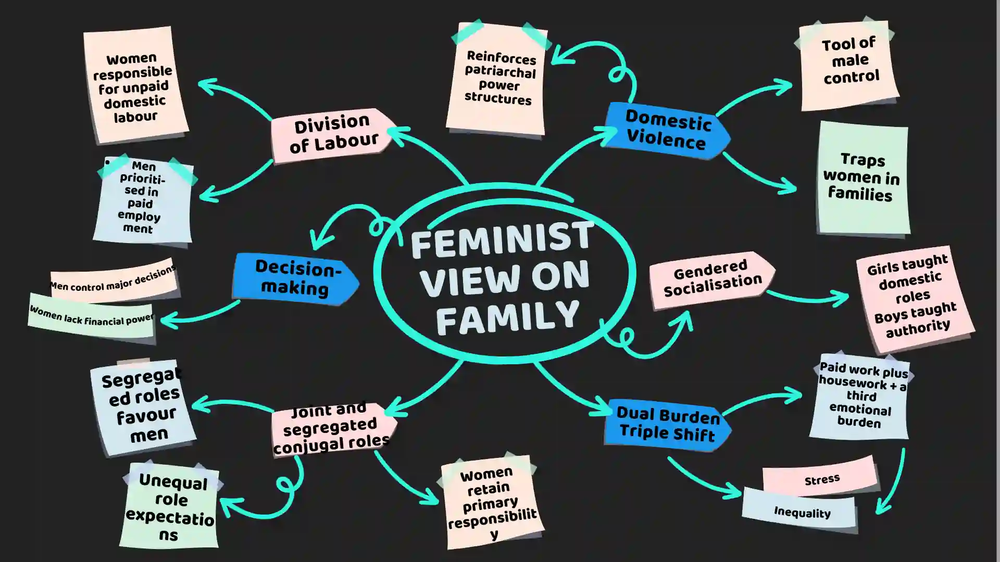

## **Feminist Views**

### How the Family Benefits Patriarchy and Male Power

* Men benefit from the family through traditional gender roles

  * Men are breadwinners and heads of the household

  * Wives provide unpaid labour: cook, clean, give emotional support

  * Wives are expected to prioritise their husbands’ interests over their own

* Family socialises children into gender roles

  * Boys and girls learn behaviours appropriate to their gender

* Wealth and inheritance remain with males

  * Sons or male heirs inherit family property and power

* Patriarchy in the family underpins wider societal patriarchy

  * Overall function of the family: maintain male dominance

* 3 types of feminists:

#|
||

Feminist Type

|

View on Family

|

Examples

||
||

**Liberal**

|

Equality is possible within society; reform, not restructure

|

Non-sexist child-rearing, men do more housework, and women pursue careers

||
||

**Marxist**

|

Family maintains women’s exploitation in capitalism

|

Exploitation linked to the economic system, unpaid labour benefits capitalism

||
||

**Radical**

|

Society is fundamentally patriarchal; major change is needed

|

Avoid exploitative relationships, live separately from men, family = part of wider male dominance

||
|#

### The Domestic Division of Labour

* Tasks in the home, such as cooking, cleaning, and childcare, are divided unequally

  * Women take primary responsibility for domestic work

* Late 20th-century feminists wanted domestic roles to become more equal

  * Equal domestic work is seen as essential for wider gender equality

  * Change has been slow, though some progress has occurred

* Even when men and women work the same paid hours, women still do more housework

  * Some men help, but the main responsibility remains with women

* Patriarchal norms maintain inequality within the home

  * Unequal domestic labour reinforces gender inequality in wider society

### Domestic Violence and Abuse

* Domestic violence was long ignored as a private family matter; some believed men had the right to use force against wives in certain situations

  * The DV study titled ‘Violence Against Wives’ published in 1979 by by Rebecca Dobash and Russel Dobash(Dobash & Dobash) showed it was widespread, including pushing, slapping, beating, rape, and sometimes murder, often when men felt their authority challenged

  * Feminists argue that male authority within marriage reinforces patriarchy, benefiting men by maintaining male dominance

* Offenders are mainly men; victims are usually women and sometimes children

  * Male victims under-report due to shame, fear of appearing weak, or social norms

  * Domestic violence remains under-reported because victims fear police inaction, worsening abuse, losing children, or believe abuse is normal or changeable, and may still love the abuser

* Children are also victims of family abuse; families can be unsafe, exploitative, or dangerous

  * Abuse often from parents or step-parents, sometimes males, with increases in reported cases reflecting better reporting rather than more abuse

  * Child abuse usually takes one of four forms: sexual, physical, emotional, or neglect

  * Children may also live in difficult situations, e.g., acting as carers or living with adults with mental health issues

### Joint and Segregated Conjugal Roles

* Feminists reject the functionalist idea that gendered family roles are fair or natural

  * Roles in marriage (conjugal roles) can be **segregated** or **joint**

* Segregated conjugal roles are typical of traditional nuclear families

  * Men and women have clearly different roles

  * Functionalists see these roles as natural, but feminists argue that they **benefit men** and reinforce patriarchy

* Joint conjugal roles involve men and women sharing instrumental and expressive responsibilities

  * Roles are integrated rather than separate

  * Feminists view joint roles as a step toward equality within the family

The following features of the female domestic role make it different from paid work:

* It’s unpaid

* no starting and finishing times.

* no benefits, such as a contract, holidays and pensions.

* not seen as 'real' work, so low status

* solitary and gives little sense of achievement because there is always more to do.

### Dual burden and triple shift

Domestic division of labour remains unequal, but men and women in Europe and North America usually perform both paid and domestic work

* For women, this creates a **dual burden**: paid work plus most domestic responsibilities

* Duncombe & Marsden found women often perform a **triple shift**: paid work, housework, and emotional work

  * Emotional work includes supporting family members with worries and concerns

### Decision-making

* Power inequalities shape decision-making within families

  * Decisions are usually made by men and reflect their interests

  * Examples:

    * Parental leave: women often take more due to social expectations and lower earnings

    * Moving home: more likely for a man’s career than a woman’s

* Women make some decisions, but these are usually about the home or children

  * Men can concede control in these areas without threatening their dominant position

### Gendered Socialisation

Feminists are worried about how boys and girls are socialised into gender roles within families

* Refer back to Chapter 2 to learn how this happens