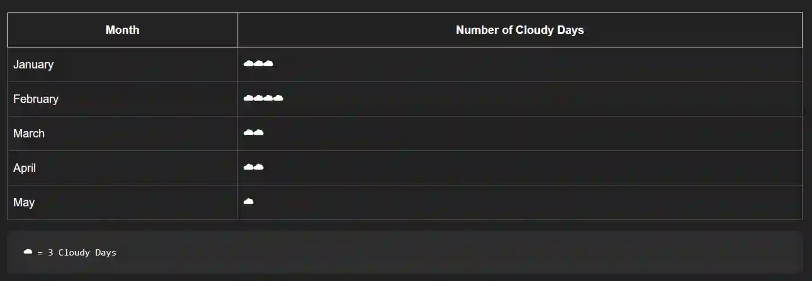

## Pictograms

* A method of representing data in which data is represented through visual symbols

* Every pictogram uses a key to show the value of the visual symbol used.

* In this case, the visual symbol is a cloud, and every cloud represents 3 cloudy days.

* ### How to Read The Pictogram:

  * To find out the number of cloudy days in a month, we can multiply the number of clouds in the table by the number of cloudy days each cloud represents.

  * For example,

    * There are 3 clouds in February

    * $3 \times 4 = 12$

    * Hence, there are 12 cloudy days in February