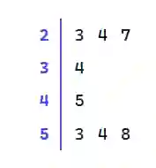
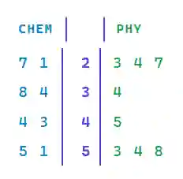

## Stem and Leaf Plots

* A method of representing data in which numerical data is displayed through “Stem" and “Leaf”.

* A Stem is a vertical column of higher place values, with corresponding rows of Leafs (usually the ones place), and is used to store data in an organized manner.

### How to Read/Make a Stem and Leaf Plot:

* For example, we are given the following values as the Physics exam results of a class.

  * 23

  * 45

  * 24

  * 53

  * 54

  * 34

  * 27

  * 58

* First, we will arrange the values in ascending order.

  * 23, 24, 27, 34, 45, 53, 54, 58

* Next, we will separate the values into a stem and a leaf.

  * For example, we have 23. The ones digit in 23 is 3, which leaves 2 behind as the higher place value.

  * Hence, 2 will be the stem, and 3 will be the leaf.

  * **ALL** numbers with the same stem should be placed in the same leaf.

$$

Key: 2 \vert 3 = 23

$$

* **ALWAYS** add a key like shown above.

* **DO NOT** use commas between the numbers.

* To make a Stem and Leaf Plot of 2 sets of data, we add the second set of data to the left of the Stem.

* This makes a Back-to-Back Stem and Leaf Plot.

* For Example, we are also given the Chemistry exam results of the same class:

  * 43

  * 51

  * 27

  * 34

  * 55

  * 38

  * 44

  * 21

$$

Key: 2 \vert 3 = 23

$$

* Ensure that you have labelled the Leafs.

* The Key must be accurate for both sets of data.

### Advantages of Stem and Leaf Plots:

* Original data values are kept.

* Trends in data (Increase, Decrease, Most common marks) are easily seen.

* Easy to make and interpret.

### Disadvantages of Stem and Leaf Plots:

* Not visually appealing.

* Not suitable for large amounts of data.