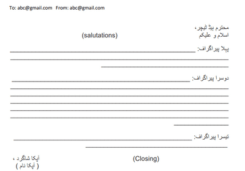
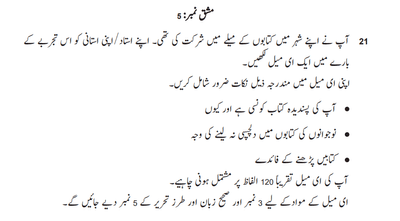
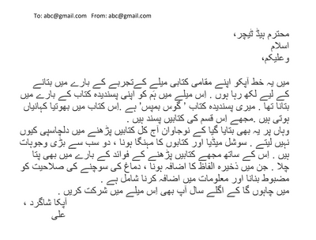

# Writing

## Email Writing

* Time to allocate: **15 minutes**

### **What it will include:**

* You will be required to write a short email in just **120 words**.
* Each question has 3 points, which you will describe in the email.

### **Format:**

 

### **Tips for Writing an Email:**

* Make sure to write an e-mail within the word limit by only describing the points in the question instead of providing details about everything.
* It is advised to briefly describe the points given in the exam paper in one paragraph each, keeping it as brief as possible because the lines in the exam paper are pretty less
* In the case of formal email writing, writing to a teacher, co-worker, etc :
  * Start directly from the purpose, e.g. میں آپ کو یہ خط اِس لیے لکھ رہا ہوں
  * Make sure to keep the tone formal and to the point
  * End the letter with a formal conclusion.
* In the case of informal email writing, writing to a friend, relative, etc :
  * Start the letter by asking about the individual you’re writing to and state your purpose for writing the email, e.g. امید ہے كے آپ خیریت سے ہوں گے
  * The tone can be informal, but keep the letter's content to the point.
  * The conclusion can be however you feel is suitable for the context of the email.

### **Example Question:**

###  **Modal Answer:**

 