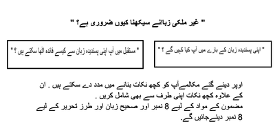
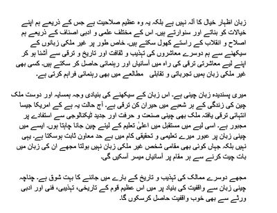

## Essay Writing

* Time to allocate: **25 - 30 minutes**

### **What it will include:**

* Along with the topic given, two points related to the topic will be provided so that you can write the essay easily.
* The goal is to understand these points properly, add points from your side and write a three-paragraph essay in **200 words.**

### **Tips for writing an essay:**

* Instead of trying to construct complex sentences, write using simple and small sentences to express your ideas.
* Divide the word limit roughly into equal words in all three paragraphs.
* Take examples from your society and daily life events to make your essay more interesting.
* Always make sure to have a proper introduction and conclusion.
* Always organize your ideas into paragraphs, so if it’s an essay that requires you to write both sides (advantages and disadvantages), write one side in separate paragraphs. Make sure to give a final opinion.
* Especially for this question, ensure proper punctuation, spelling, and grammar, as this part of the paper assesses all these three skills. So, never forget to proofread what you write.
* While writing an essay, make sure to use connecting words to give it a good flow
* some good words and phrases to be used in essays

| **In my opinion** | میری رائے میں |
|----|---:|
| I am in favor of | میں اس کے حق میں ہوں |
| Even though | اگرچہ |
| furthermore | مزید |
| moreover | بلکہ |
| And | اور |
| or | یا |
| but | لیکن |
| finally | آخر |
| I believe that | مجھے یقین ہے کہ |

* Along with the words mentioned above/phrases, you can refer to the table in summary writing.

### **Format:**

* In the case of a one-sided Essay:
  * **Paragraph 1:** Introduction
  * **Paragraph 2:** Include both points in the question and your thoughts on the topic in this paragraph.
  * **Paragraph 3:** Sum up all the points you mentioned above.
* In the case of a two-sided Essay:
  * **Paragraph 1:** Introduction: this needs to be general.
  * **Paragraph 2:** Divide this paragraph into sub-paragraphs
    * in the first part, write about one side
    * in the second part, write about the other side
    * there is no need to show your support at this stage of the essay clearly
  * **Paragraph 3:** conclude your essay by clearly mentioning which side you support and backing it up with one more point.

### **Example Question**

 

### **Modal Answer**

 