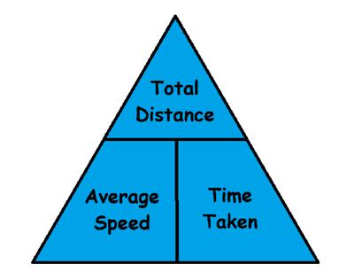

## **Equations for speed**

* $\text{Speed (metre per second, m/s)} = \frac{\text{Distance(metre, m)}}{\text{Time(s)}}$

* $\text{Distance travelled} = \text{Average speed} \times \text{Time (should be memorised)}$

### **How to calculate the average speed of an object:**

* In most cases the speed of an object can never be constant, for example an object can lose speed due to friction or gain speed if more force is applied.

* $\text{Average speed} = \dfrac{\text{total distance}}{\text{total time taken}}$

* This formula can easily be remembered using the formula triangle down below:

  \
  