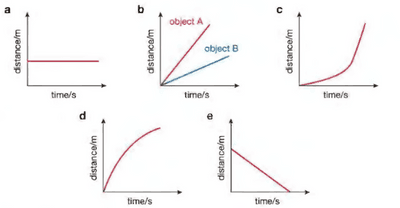

## **Distance/Time graphs**

* Distance/Time graphs are used to represent how far an object has travelled in a given time period. The gradient of the slope represents speed, since speed = $\frac{\text{distance}}{\text{time}}$ and the formula for the gradient is $\frac{\text{change in y(distance)}}{\text{change in x(time)}}$.

  \
  

* The steeper the gradient, the higher the speed.

* In graph a, the object is not moving/stationary as the gradient = 0, since the line is flat and distance does not change with time. 

* In graph b, object A is moving faster than object A as the gradient of object A is steeper, meaning it covers more distance in the same time. 

* In graph c, the object moves slowly then suddenly accelerates into a high speed (line becomes steeper), showing the gradient increases with time. 

* In graph d, the speed is decreasing (gradient decreases over time), as the line flattens and distance increases more slowly. 

* Lastly, in graph e, the speed is constant (straight line so the gradient doesn’t change), showing equal distance is covered in equal time. 