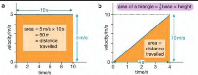
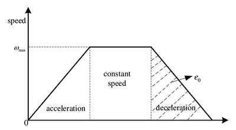

## **Velocity/Time graphs**

* Velocity is speed in a stated direction.

* Velocity time graphs are used to represent the velocity of an object at a given time.

* Using a velocity time graph the acceleration can be found using the gradient as acceleration = $\frac{\text{Change in velocity}}{\text{Change in time}}$ and the gradient is $\frac{y_2 - y_1}{x_2 - x_1}$

* To find the distance travelled you would calculate the area under the graph like shown in this image:

  

* This works as distance = speed x time.

* This graph shows constant acceleration from rest, constant speed, and constant deceleration.
* A negative gradient shows deceleration: the object is slowing down. 