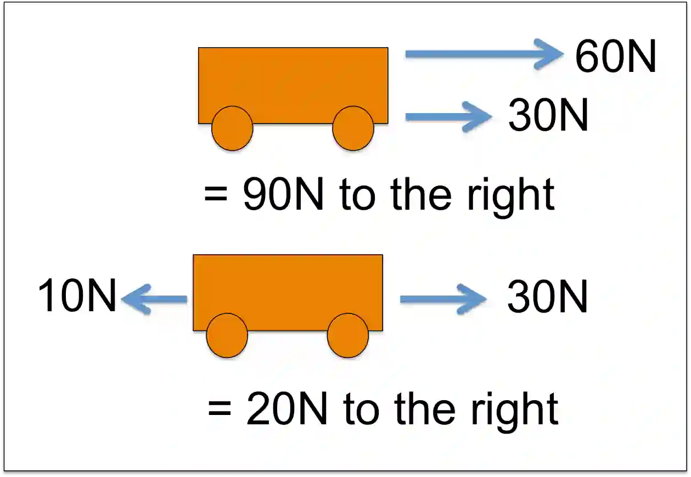

# **Forces and Motion**

## **Resultant Forces**

### **Definition:**

* The resultant force is the vector sum of all individual forces acting on an object.

### **Balanced and Unbalanced forces:**

* Balanced Forces: When the resultant force is zero, the object remains at rest or moves with constant velocity.
* Unbalanced Forces: When the resultant force is non-zero, the object accelerates in the direction of the resultant force.

### **Calculation:**

* To calculate a resultant force, sum up all the individual forces acting on an object, taking both magnitude and direction into account.
* This means that if one force of 10N act on the right of an object and one force of 15N were to act on the left of an object the resultant force would be 5N to the left. 

  
* However if you had a force of 10N directed north and 5N directed east you would make a triangle and use the Pythagorean theorem to find the resultant force. Which would be $\sqrt{10^2+5^2}$ = 11.2N direction.