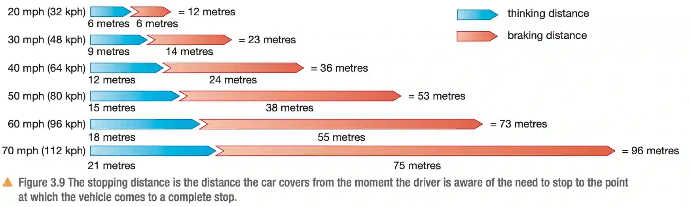

## **Stopping Distance**

### **Definition:**

* The stopping distance is the total distance travelled by a car from the moment the driver sees the reason to stop to the moment the car stops completely.

* The equation for stopping distance is the thinking distance + the braking distance.

* Thinking distance: distance travelled from driver seeing the need to stop so that they can start applying the brake.

  Braking distance: distance travelled between starting to apply the brake and the car stopping completely.

* In case of emergency, when the distance between the car and upcoming object is less then the thinking distance, this could lead to a collision.

  

### **Factors affecting thinking distance:**

* Drugs

* Tiredness

* Distractions such as your phone

* Poor visibility

### **Factors affecting breaking distance:**

* Vehicle condition such as worn out tires and strength of the brakes.
* Road conditions i.e if the road was slippery it would be harder to decelerate.
* Vehicle mass.
* Vehicle’s speed
* Driver’s reaction time
* The friction between the road and tyre.

### **Calculation:**

* To calculate the braking distance using breaking force, velocity and mass you would use this formula braking distance = $\frac{\frac{1}{2} \times \text{mass} \times \text{velocity}^2}{\text{Braking Force}}$
* $\text{Thinking distance} = \text{reaction time} * \text{speed}$

### **Dangers of large deceleration:**

* Large deceleration is very dangerous, especially for heavy vehicles, because it requires a huge amount of force.

* When the brakes are applied, a strong friction force is created between the wheels and brakes. This quickly turns the vehicle's kinetic energy into heat energy .

* Additionally, the people inside are thrown forward with great force, which can cause serious injuries to their heads, necks, and spines.

### **Work Done and Kinetic Energy:**

* The work done in bringing a car to a stop is the transfer of all kinetic energy into other forms.
* Work done = Energy
* The formula for work done is $\text{force} * \text{distance}$
* The formula for kinetic energy is $\frac{1}{2} \times \text{mass} \times \text{velocity}^{2}$
* So, $\text{force} \times \text{distance}$ = $\frac{1}{2} \times \text{mass} \times \text{velocity}^{2}$
* $F = \frac{mv^2}{2d}$
* **$F \propto v^2$**
* So doubling v would increase F by 4 times.