## Energy Diagrams

* Energy transfer diagrams are used to illustrate how energy flows and transforms in a system. Simple boxes can be used to represent the energy flow.

* The flow diagram below illustrates the energy change when boiling water in a kettle.

* This type of diagram shows only the type of energy changes, not the amount of energy transferred in a system.

  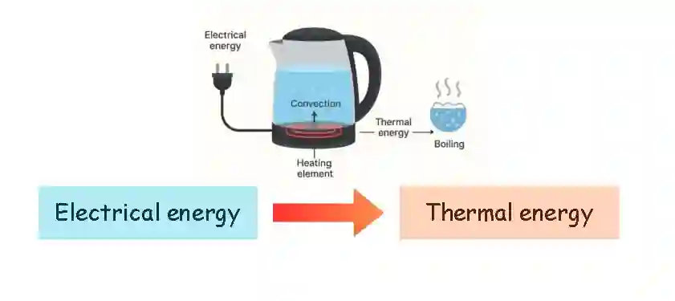

* Below are some more examples of energy transfer diagrams

**a) A ball being thrown into the air**

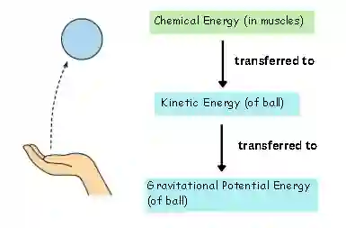

**b) A car accelerating with constant force**

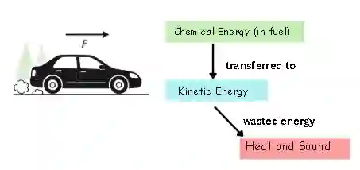

**c) A car slowing down**

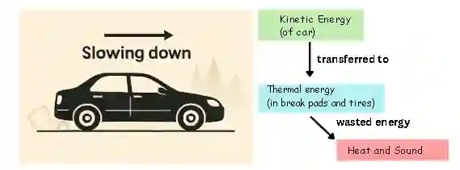

**d) A hammer falling on the floor**

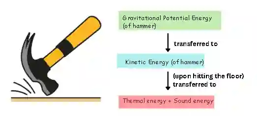

**e) Electric kettle being used to boil water**

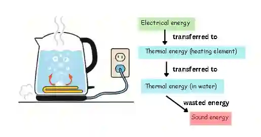

* As energy is always conserved, the total energy in must be equal to the total energy out. This is true for energy transfers in every system.

### **Sankey diagram**

* A Sankey diagram is a type of energy transfer diagram that illustrate how efficiently energy is transferred in a system. It uses arrows that split up to show individual energy transfers.

* The flat end of the main arrow, drawn on the left side, represents the total input energy supplied, while the width of each arrow is proportional to the amount of energy it represents.

* A horizontal arrow pointing to the right shows the useful output energy, and the side arrows represent wasted energy transfers.

* A Sankey diagram also shows the efficiency of a system; the wider the useful output arrow compared to the input arrow, the more efficient the energy transfer.

  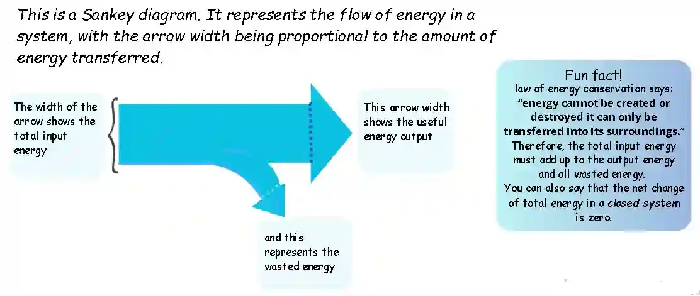

The following steps can be used to draw a Sankey diagram:

1. Identify the system’s energy inputs, useful outputs, and wasted energy.

   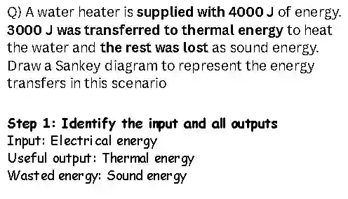

2. Use the energy values from the question (e.g., 7000 J input, 4000 J output, 3000 J wasted).

   * ensure the total input energy equals to the sum of the all energy outputs (useful+ wasted energy)

     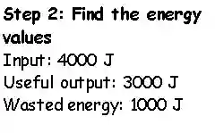

3. Choose a set scale to convert energy values into arrow widths. Example: 1cm= 1000 J.

   * Use this scale to draw arrow widths proportional to their energies.

     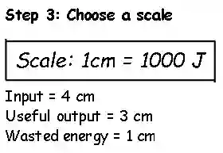

4. Draw the input arrow horizontally, with it’s width proportional to the total input energy.

   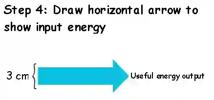

5. From the end of this arrow, add horizontal arrows to show the outputs; one showing the useful output energy, and one or more to show the wasted energy.

   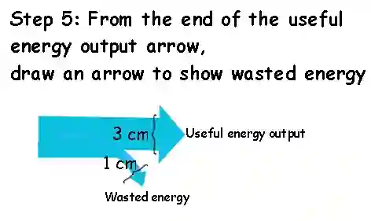

6. Label each arrow with it’s energy value and clearly state its type (input, output and wasted energy). The width of the output arrows combined must equal the width of the input arrow.

   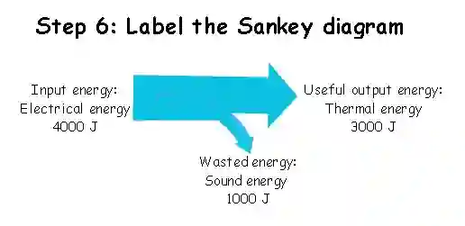

   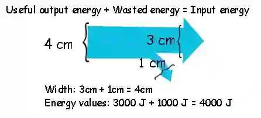

### **Example question:**

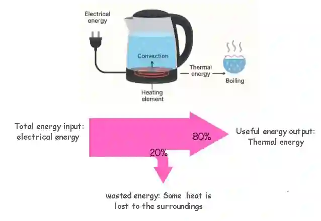

Q.) The Sankey diagram above shows how efficiently energy is transferred when boiling water in a kettle.

a) Explain what the diagram shows about the efficiency of the kettle, and state the useful and wasted energy outputs.

b) Assuming the kettle is supplied with 3000 J of electrical energy, workout the useful energy output.

**Answer:**

Part a)

The diagram shows that the kettle is 80% efficient, which means 80% of the input electrical energy is converted into useful thermal energy to heat and boil the water. The remaining 20% of the input energy is wasted to the surroundings as heat and sound energy.

Part b)

efficiency **=** $\frac{\text{useful energy transferred by the device}}{\text{total energy supplied to the device}}$ x 100

80 = $\frac{\text{Useful energy output}}{3000 J}$ x 100

$\text{Useful energy output}$ = $\frac{80 \times 3000J}{100}$

$\text{Useful energy output}$ = 2400 J

This means that 2400 J of the supplied electrical energy is efficiently transferred to thermal energy used to boil the water.