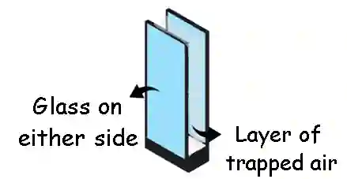
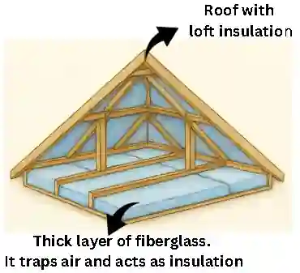
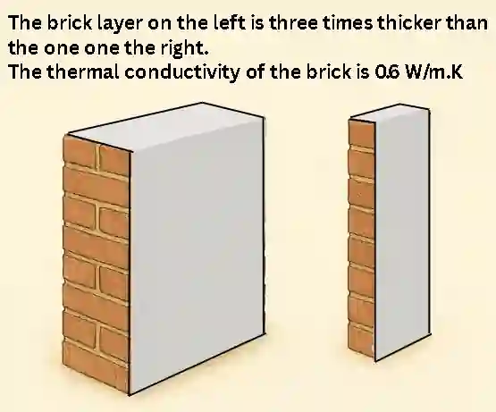
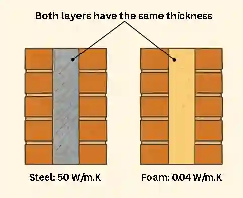

## **Thermal Energy**

### **Methods of transport**

* **Conduction** - Transporting heat energy through direct contact between particles. Solids, especially metals, are the best  conductors.
* **Convection** - This occurs in fluids (liquids and gases) where warmer, less dense regions of a fluid rise while cooler, denser regions sink, creating a convection current.
* **Infrared radiation** - Heat can also be transferred through electromagnetic waves. Dark, matt surfaces are the best absorbers and emitters of heat while light, shiny surfaces reflect heat and act as better insulators.

### **Ways of reducing unwanted energy transfers**

Efficiency is increased by reducing unwanted thermal energy transfers. This can be achieved using:

1. **Thermal insulation:**

   * **Double Glazing**: Windows with two layers of glass separated by an air gap reduce energy transfer by conduction and convection.

     

   * **Loft Insulation**: A layer of insulating material (like fiberglass) placed in the roof space reduces heat loss through the ceiling by trapping air and reducing conduction and convection.

     

   * **Carpets and Rugs**: These can help insulate floors by trapping air and reducing heat loss through conduction and convection.

2. **Lubrication:**

   * Moving parts in mechanical systems create friction which produces heat. Lubrication reduces the friction at these contact points, so less energy is dissipated as heat to the surroundings, increasing efficiency.

* Some common lubricants and their uses are listed below.

#|
||

Lubricant

|

Usage example

||
||

Machine oil

|

Used in car engines to reduce friction between moving parts

||
||

Engine oil

|

Used in machines such as sewing machines, fans, small mechanical tools

||
||

Grease

|

Lubricates kitchen appliances, door hinges, shower sliders

||
||

Graphite

|

It is used to lubricate moving parts where oil is not suitable

||
||

Petroleum jelly

|

Lubricates small household mechanisms such as door hinges

||
|#

Both of these methods can be used to effectively reduce heat loss. By doing so, more energy is retained to heat the building and the overall efficiency increases since less energy is wasted.

### **Thermal Conductivity**

* Thermal conductivity measures the ability of an object to conduct heat. A higher value indicates a faster thermal energy transfer by conduction. The table lists various materials along with their their thermal conductivity, and how well they transfer heat by conduction.

  #|
  ||
  
  Material

  |
  
  Thermal Conductivity (W/m·K)

  |
  
  Conduction ability

  ||
  ||
  
  Silver

  |
  
  429

  |
  
  Excellent (very high)

  ||
  ||
  
  Copper

  |
  
  401

  |
  
  Excellent

  ||
  ||
  
  Aluminum

  |
  
  237

  |
  
  Very good

  ||
  ||
  
  Brass

  |
  
  109

  |
  
  Good

  ||
  ||
  
  Steel (mild)

  |
  
  50

  |
  
  Moderate

  ||
  ||
  
  Brick

  |
  
  0\.6 - 1.0

  |
  
  Poor

  ||
  ||
  
  Air

  |
  
  0\.025

  |
  
  Extremely poor

  ||
  |#
  

* From the table it can be observed that a higher thermal conductivity value indicates the material transfers heat energy more quickly. It also means that the material will be a poor insulator and the energy loss will be greater.

* The thickness of material also affects how well it retains heat. A thicker layer of a material with low thermal conductivity will be more efficient at reducing heat loss compared to a thinner layer of the same material.

### **Example question:**

Q1)The diagram shows two walls with different thicknesses of brick layers  acting as insulation. Describe how heat is transferred through the wall and state which wall will be more effective at retaining heat in a building. In your answer, refer to thermal conductivity of the material, thickness, and the heat transfer processes involved.

**Answer:**

* Heat energy is transferred through the brick wall by conduction, and from the outer surface to the surroundings by convection.

* The value of 0.6 W/m·K shows that brick has a low thermal conductivity, therefore the rate of heat transfer to the surroundings will be slow. A thicker brick layer provides a longer path for the heat energy to travel before being dissipated, and also allows some heat energy to be absorbed by the bricks. This causes a further decrease in the rate of heat loss.

* Therefore, the thicker wall will be more efficient at retaining heat, and the building will cool more slowly

Q2) The diagram shows two walls of same the thickness, each made of a different insulating material. Using your understanding of heat transfer and thermal conductivity, determine which material will be a better thermal insulator for a building. Refer to the thermal conductivity, thickness, and the rate of heat transfer in your answer.

**Answer:**

* Heat energy can be lost to the surroundings through the materials by conduction, and through air by convection.

* Since the materials have the same thickness, the distance the heat energy needs to travel before being dissipated is the same. Therefore, the main factor affecting the rate of heat loss will be the thermal conductivity of the insulators.

* The thermal conductivity of foam is 0.04 W/m·K, which is much lower than that of steel, so the rate of heat transfer through foam will be much slower.

* Hence, foam is more efficient at reducing heat loss, and the building will cool down more slowly.