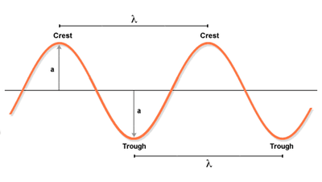

# **Waves**

## **Describing Waves**

### **Introduction to waves:**

* Waves transfer energy and information without transferring matter.
* They can be described as oscillations or vibrations upon a fixed point.

### **Wave Graphs and Terms:**

* **Frequency -** Number of waves passing through a point per second, it is measured in Hz.
* **Period -** Time taken per oscillation.
* **Amplitude -** Maximum displacement of a wave from its undisturbed point.
* **Speed -** How fast a wave travels.
* **Wavelength -** Distance from one point of a wave to the same point on the next wave.

   

### **Calculations:**

* The formula for wave speed is frequency x wavelength.
* The other formula for wave speed is $\frac{\text{distance}}{\text{time}}$.

### **Transverse Waves:**

* A transverse wave is a type of wave where the particles of the medium move at right angles to the direction in which the wave travels.
* **Crest and Trough**: The highest and lowest points of the wave
* One example of a transverse wave is light waves.

### **Longitudinal Waves:**

* A longitudinal wave is a type of wave where the particles of the medium move parallel to the direction in which the wave travels.
* It has compressions and rarefactions.
* One example is sound waves.

