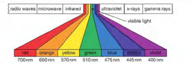

## **Electromagnetic Spectrum**

### **The Electromagnetic Spectrum:**

 

* The EM spectrum contains 7 waves that all travel at the speed of light (around 3 x $10^8$m/s).
* The 7 waves are:
  * Radio Waves - Used for communication
  * Microwaves - Used for satellite
  * Infrared - Used for cooking and remote controls
  * Visible Light - To see
  * Ultraviolet - tanning and killing bacteria
  * X-Rays - To see through things
  * Gamma - For medicine
* At the start of the EM Spectrum (Radio waves) the waves have higher wavelengths and shorter frequencies.
* As you get to the end you can see the wavelength shortens and the frequency increases.
* The colors in the spectrum are like in a rainbow red to violet where radio waves are red and gamma waves are violet.
* The only electromagnetic wave we can see is visible light.

### **Dangers of each wave:**

* Radio Waves - Chance of burns
* Microwaves - Tissue burning, damaging internal organs
* Infrared - Thermal Burns
* UltraViolet - Skin Burns
* X-Rays - Cancer
* Gamma - Cancer and Death

### **When an EM wave interacts with an atom:**

* When an EM wave hits an atom, it can be absorbed by one of the electrons giving it energy
* This causes the electron to move up to a higher energy level

* Then an electron will move back down to a lower energy level and will emit an EM wave in the process

### **How are each of these waves created:**

* Radio Waves - They are created with oscillating electric charges, creating an alternating current which produces electromagnetic waves that radiate outwards.

