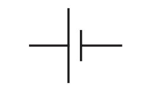
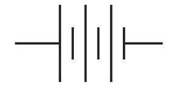
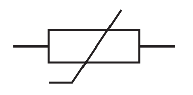
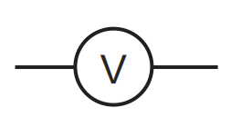
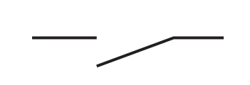
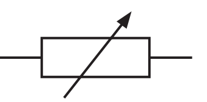

# Electricity
## Electric Circuits

- The symbols are as follows

| Component | Symbol | 
| -------- | -------- |
| Cell   |      |
| Battery    |    |
| Lamp |  |
| Fixed Resistor|  |
|Thermistor|  |
|Voltmeter|  |
|Ammeter|  |
|Switch|  |
|Variable Resistor| |

- For series circuits, all components are placed in a single loop.
- For parallel circuits, components are placed in multiple loops, with each loop connected to both positive and negative terminals of the battery.
- Ensure that voltmeters are drawn in parallel across components and ammeters in series.
### Series circuits:
- All lamps share the same current, so the brightness is lower because the voltage is shared among all lamps.
- If one lamp fails, the entire circuit is broken and all lamps go out.
### Parallel circuits:
- Each lamp receives the full voltage from the power source, so all lamps are equally bright.
- If one lamp fails, the other lamps remain unaffected because each lamp has its own independent loop.