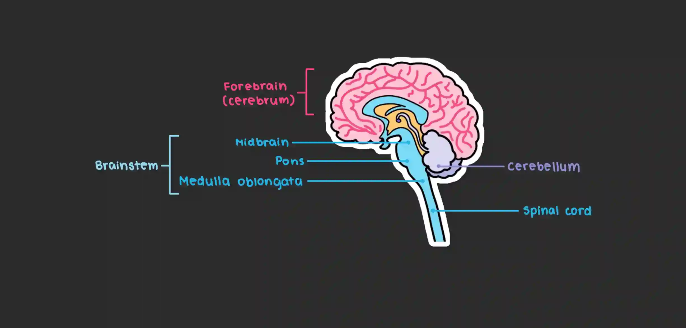

# Development

## Early Brain Development

* A long tube develops at 3 to 4 weeks old, dividing into three round sections: the forebrain, midbrain and hindbrain
* It splits into the anterior and posterior sections by five weeks, with the midbrain remaining undivided
* Around six weeks, the cerebellum becomes visible, which plays a role in fear and muscle activity
* Around the 20th week, the medulla oblongata connects the upper brain to the spinal cord and is responsible for automatic responses

### **Parts of the Brain**

* The forebrain is located in the anterior part of the brain and consists of two hemispheres
* The midbrain is situated in the middle section of the central nervous system (CNS)
* The hindbrain is found in the lower part of the brain and includes the cerebellum, pons, and medulla oblongata
* The Medulla Oblongata is a structure that connects the upper brain to the spinal cord and governs automatic responses (e.g., sneezing, heart rate and breathing)
* Anterior is the section of the brain that’s directed towards the front
* Posterior is the section of the brain that’s directed towards the back
* The Cerebellum controls the motor movements of the body

