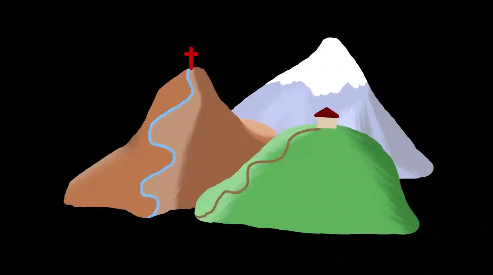

## Piaget & Inhelder (1956): ‘Three mountains’ task

### **★** Background:

* According to Piaget’s stages of cognitive development, children in the pre-operational stage can view the world from their own viewpoint, but not from others’; this is called ‘*egocentrism*’ – focused on the self

  * likely to change how the world looks to fit how they see it

* The ability to understand others’ viewpoints develops over time, which takes place in the concrete operational stage

  * skill is called ‘*decentre*’ – can see viewpoint of someone else and consider multiple views

### **★ Aims:**

To investigate:

* extent to which various-aged children’s ability to take the viewpoint of another person

* children’s overall cognitive process of constructing numerous different views of what they see

### **★ Sample:**

**100 children were used:**

* 21 were aged between 4 – 6.5 years old
* 30 were aged between 6.5 – 8 years old
* 33 were aged between 8 – 9.5 years old
* 16 were aged between 9.5 – 12 years old

### **★ Procedure:**

* **Apparatus – 4 main pieces:**

  * Three mountains, 12–30 cm high, made using sheets of paper pasted together
    * Lowest mountain was green, and had a house on top and a winding path

    * Second highest mountain was brown, and had a red cross on top and a stream coming down

    * Highest mountain was grey, and has snow on top

  

  * 10 pictures of the three mountains taken from different positions
    * Pictures were taken so all features were visible and colours were clear
  * Three pieces of cardboard shapes, the same colour as the mountains
    * Used so the child could arrange them to represent the order of the mountains according to a certain viewpoint
  * Wooden doll, \~3 cm tall, no facial features
    * Used for the child to position so it can ‘see’ the asked viewpoint

* **Methods of questioning the child:**

  1. Arrange the cardboard shapes to show how the mountain scene looked like from different viewpoints

     * Also asked to arrange the shapes according to what the doll (positioned by the researcher) could ‘see’

  2. Shown the 10 pictures of the model and asked to choose the one that represents their viewpoint

     * Also asked to choose the picture the doll could ‘see’ from different positions the doll was positioned at

  3. Choose a picture and place the doll so they could ‘see’ that viewpoint

### **★ Results:**

* **Pre-operational stage (4 – 6.5 years old)**

  * Chose pictures and arranged the cardboard shapes of their own view, even when asked to demonstrate the doll’s viewpoint
  * Could not place the doll in the position the picture that was shown
  * Though older children in this stage start to realise there are other viewpoints, they still showed egocentrism overall

* **Concrete operational stage (7 – 12 years old)**

  * From 7–9 years old, children start to understand others viewing the model from a different position see it differently
  * By 9–10 years old, children understand the doll has a different view when placed in a position that is different to their own

Piaget and Inhelder collected *qualitative data* (data in the form of words or that gives descriptions), including observations about individual children.

### **★ Conclusions**

* **Pre-operational stage:**

  * Egocentric up to 7 years old – could not see other people’s viewpoints other than their own
  * Though, near the end of the pre-operational stage, they do think about others’ viewpoints
  * Children in this stage do not have a solid understanding of “viewpoint” yet

* **Concrete operational stage:**

  * Non-egocentric

  * Ability to view objects related to one another – larger objects can block a smaller one

  * Can describe their own viewpoint among others

  * Can construct mental representations of others’ viewpoints

  * Overall had the ability to co-ordinate various perspectives that younger children could not do

* Experiment provides evidence for Piaget’s stages of development

  * Pre-operational stage children are egocentric and could not take on different views other than their own

  * Concrete operational stage children overcome egocentrism and could take on different views other than their own

    #|
    ||
    
    **STRENGTHS**

    |
    
    **WEAKNESSES**

    ||
    ||
    
    **Collected qualitative data:** observed children’s behaviours during the study, and detailed notes were made regarding the children from each stage of cognitive development; rich detail means more context, so it maintains the validity of the findings

    |
    
    **Sample bias:** only consisted of Swiss children,; children from other cultures may develop differently, and certain cultural beliefs/values/norms they were brought up with may affect the way they interpret the ‘three mountains’ task, so it is difficult to generalise to children of different cultures due to its ethnocentrism

    ||
    ||
    
    **Use of experimental research method:** Piaget and Inhelder utilised a laboratory research experiment method, which suggests strict controls were in place to ensure no uncontrolled extraneous variables affected the procedure and outcome (results) of the study, so it has strong cause-and-effect conclusions

    |
    
    **Conflicting evidence:**

    * **Borke (1975)**: altered the task Piaget and Inhelder used, making it more appropriate, utilising a popular character (“Grover” from *Sesame Street*) and adding a turntable to the model; found children were capable of understanding another person's perspective, suggesting previous conclusions regarding egocentrism were due to the children finding the tasks too difficult

    * **Repacholi and Gopnik (1997)**: showed that young children were not as egocentric as Piaget thought; they showed children at 18 months old were able to understand another person’s desires and emotions, when the researcher expressed dislike for the cracker but liking for the broccoli

    ||
    ||
    
    **Standardisation:** all children were asked to do the same ‘three mountains’ task using the same apparatus, and were asked the same question of identifying the picture of the researcher and the doll’s view, so this suggests the study can be replicated to test for reliability

    |
    
    **Lacks ecological validity:** conducted in a controlled setting and utilised a strange/artificial task, which may not represent real-world scenarios where egocentrism and decentration are used/seen

    ||
    ||
    
    **Piaget’s ideas explored more in depth:** this in-depth research further supports Piaget’s early ideas on cognitive development as it focuses and explores egocentrism, and how it decreases as children move on to higher stages of cognitive development

    |
    
    **Researcher bias:** Piaget is heavily criticised for only focusing on the “success and failures” of children, failing to fully highlight that though children at the age of 7 were not able to fully see the viewpoint of others, they almost could do this, or did it occasionally (inconsistently); this contradicts the theory being “staged”, but rather a staggered transition

    ||
    |#
    
