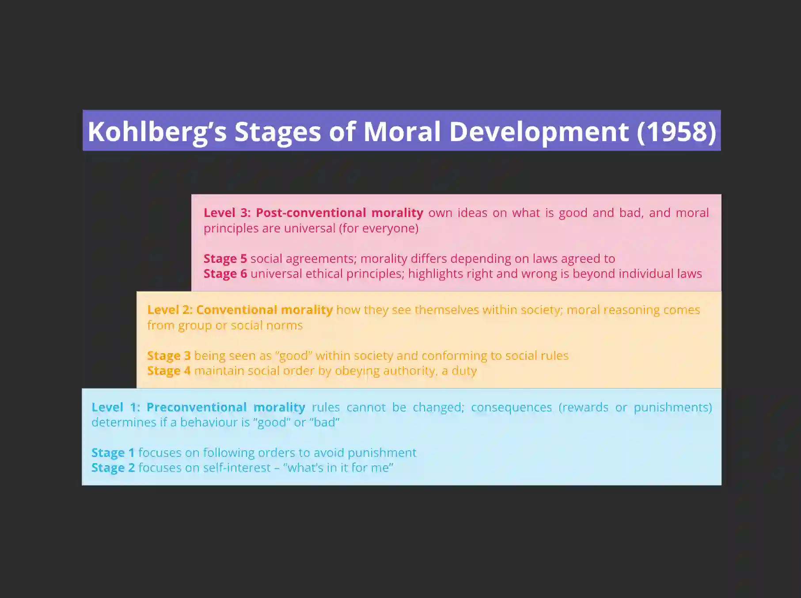

## Issues and debates: The development of morality

* **Morality:** this is a general term for human conduct which comes about because of their morals – it is largely concerned with the separation of good and bad behaviour
* **Morals:** these are the specific ‘rules’ that govern the behaviour and actions that a person will take on a daily basis

### Piaget’s theory on Moral Development:

* **Pre-moral**

  * 0–5 years old

  * occurs in sensorimotor and pre-operational stage

  * have very little to no understanding of the rules

  * focus on self rather than intentions (egocentric)

  * do not engage in moral reasoning

* **Moral realism (heteronomous morality)**

  * 5–9 years old

  * occurs in pre-operational and concrete operational stage

  * believes rules are rigid/unchangeable and established by authority figures

  * rules are the main moral reasoning (dictates what is right/wrong)

  * consequences dictate severity of behaviour rather than intentions

* **Moral relativism (autonomous morality):**

  * from 10 years old and above

  * occurs in concrete operational and formal operational stage

  * understand rules can be changed under certain/specific circumstances

  * consider intentions rather than directly observable behaviour or assumed/quick judgements

  * value fairness, cooperation, justice, and unity

### **Kohlberg’s Stages of Moral Development:**

* **Pre-conventional Morality (Age up to 9 years old):**
  * *Obedience and Punishment:* Children act to avoid punishment, focusing on external consequences.
  * *Individualism:* Children prioritize personal gain, considering what benefits they receive from moral actions.
* **Conventional Morality (Most young people and adults):**
  * *Relationships:* Individuals act morally to maintain a positive image among peers, aligning with group norms.
  * *Law and Order:* Moral behavior is driven by upholding societal rules, viewing it as a duty to maintain social order.
* **Post-conventional Morality (Only 10% of the population reach this stage):**
  * *Social Contract:* Individuals see laws as social contracts, acknowledging moral differences based on agreed-upon laws.
  * *Universal Principles:* Development of personal morals and laws independent of societal norms.

### **Damon (1999) on Developing a Moral Self:**

* **Early Infancy:**
  * Children exhibit global empathy, with feelings towards others similar to those towards themselves.
* **Ages 1 to 2 years:**
  * Children recognize others' distress but may not know how to respond effectively.
* **Early Childhood:**
  * Children overcome egocentrism, understanding different viewpoints and reacting to someone's distress.
* **Ages 10 to 12 years:**
  * Children grasp societal issues, realizing challenges like poverty and disabilities in others.

‎‎‎‎‎‎‎‎‎‎‎ ‎

**\*EXAM ADVICE\*** Even though the specification mentions they will only assess/ever ask questions to candidates regarding *Kohlberg’s Stages of Moral Development*, you are expected to know other theories of moral development to mention in your evaluations (AO3).