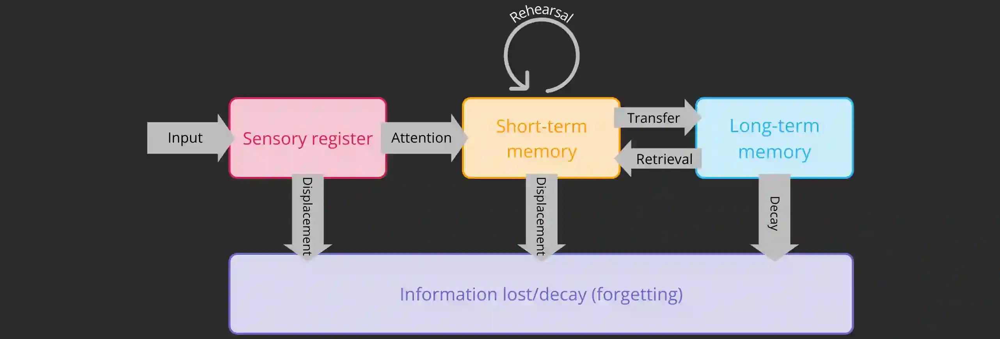

## Atkinson and Shiffrin (1968): Multi-store Model of Memory

**The Multi-store Model of Memory (MSM) comprises of:**

* Sensory register

* Short-term memory (STM)

* Long-term memory (LTM)

  (more information about short-term and long-term memory stores are outlined above)

### Sensory register and attention

* The sensory register briefly holds all incoming sensory information
* Sensory information can only move from the sensory register when we give **attention** to the incoming information; otherwise, it decays
  * Attention: focusing on the incoming sensory information
* Believed that we have a separate sensory register for each of our five senses
* Sensory registers for vision have been researched the most
* Types of sensory registers include
  * iconic memory (visual)

  * echoic memory (auditory)

  * gustatory memory (taste)

  * olfactory memory (smell)

  * tactile memory (touch/texture)

### Role of rehearsal

* **Rehearsal:** repeating information over and over again (out loud or in our heads)

* The MSM states if we rehearse information in STM, it can be held onto for longer

* The more we rehearse the information held in STM, it can be transferred to LTM

#|
||

**STRENGTHS**

|

**WEAKNESSES**

||
||

**Evidence:**

* **Murdock (1962):** discovered the *serial position effect*, where we tend to recall more information in the beginning and at the end, because the information has been rehearsed and transferred to LTM (primacy effect), and the information is still being held in STM (recency effect)

* **Peterson and Peterson (1959) (KEY STUDY):** showed the importance of rehearsal, and how lack of rehearsal led to decay of information in the STM, showing support for role and emphasis of rehearsal in the multi-store model, and duration of STM

|

**Overemphasis on rehearsal:** not the only factor that determines whether or not something is remembered; example, we can remember meaningful/personal memories easily without constant rehearsal

||
||

**Clear-cut and simple model:** The model provides a clear structure of how memory flows; this allows other researchers to easily test it

|

**Contradictory evidence and newly proposed model:** Baddeley and Hitch (1974) believed STM was not a single store, but rather had multiple stores that served different purposes, meaning memory flow is not a one-way process like the multi-store model proposed; proposed another model called the *Working Model of Memory* (WMM), which demonstrated the different stores STM had and its core functions

* Also demonstrated this by showing our STM has different stores for visual information and verbal rehearsal (Baddeley and Hitch (1976))

||
||

**Evidence from amnesia patients:** H.M. (Henry Molaison)’s (2009) case study showed how the STM and LTM were different stores; post-brain surgery, H.M.’s STM remained intact, but could never form new long-term memories

|

**Contradictory evidence from amnesia patients:** The case of Clive Wearing (2012) showed LTM was not a single store, but rather a possibility that we have multiple LTM stores; Wearing was able to recall some parts of his LTM, such as playing the piano, but was unable to recall personal events, so this challenges the idea that memory works in the same way/route in every individual

||
||

ㅤ

|

**Questionable applicability:** many studies that test this theory were conducted in laboratory settings and utilise artificial tasks, which lack ecological validity and mundane realism, so any findings produced may not reflect how we use memory in-real life settings

||
|#

