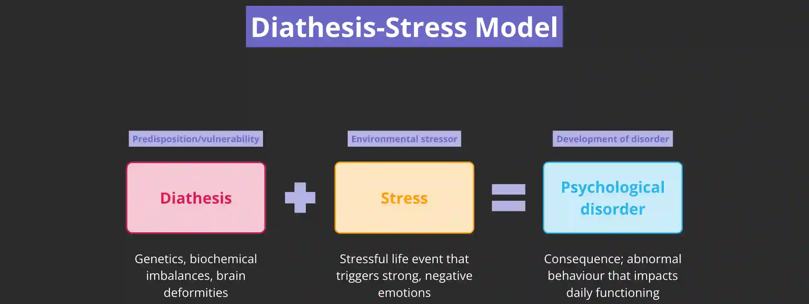

## Genetic explanation of depression

### **Genetic influence on depression:**

* Depression is hereditary, carried in our DNA, and more likely to occur in families. **Craig Hyde et al. (2016)** identified 17 gene variations linked to depression development

### **Twin studies:**

* **Peter McGuffin et al. (1996)** found that if one genetically identical (monozygotic) twin became depressed, there was a 46% chance the other would too
* In contrast, if a dizygotic twin became depressed, there was only a 20% chance their twin would follow suit
* This means monozygotic twins have a higher *concordance rate* compared to dizygotic twins
  * \*\*Concordance rate: \*\*refers to the probability a pair will share the same trait, in this case, genes related to depression

### **Diathesis-stress model:**

* Suggests that individuals possess a gene predisposing them to depression, which is triggered by a stressful event
* *Genetic predisposition \+ environmental factors = depression*
* **Genetic predisposition:** refers to the vulnerability to become depressed due to one's genes

#|
||

**STRENGTHS**

|

**WEAKNESSES**

||
||

**Abundance amount of research done:** research mentioned above; additionally, Caspi et al. (2003) (KEY STUDY) found certain variations in the alleles of the 5-HTT gene linked to imbalances in serotonin transporter molecules, which means genes do have a role in the development of depression; genes determine how our nervous system is coded

|

**Too deterministic:** an issue with the genetic explanation is that it implies if you are born with a certain set of genes, you are automatically ‘set’ for depression and have no control over this (deterministic); critics argue humans have some degree of control over their behaviour, and can ‘choose’ to be depressed or not (free will) – emphasises on control over thought patterns

||
||

**Reduces stigma:** when we know genes can affect mood and cause mood disorders like depression, the stigma from being diagnosed with depression can be reduced; if developing depressed is in your genes, people cannot blame the person because this is out of their control, so society might be less discriminatory of people with depression

|

**Reductionist explanation:** doesn’t consider other factors that may play a crucial role in the development of depression, such as stressful life events; it is too simplistic to assume a complex mood disorder like depression is due to a single factor

||
||

**Objective research methods and findings:** genetic research utilises scientific methods to analyse and test genes (such as collecting and analysing blood samples); this is free from researcher bias, so findings and conclusion remain objective and maintain internal validity

|

**Inconsistent evidence:** Hek et al. (2013) found large *genome wide association studies* *(GWAS)* do not consistently find a pattern of genes that are directly linked to depression; this means the explanation may lack reliability

* GWAS: an observational research method that studies gene variations of a large sample

||
||

**Adoption studies:** Wender et al. (1986) proved there was a biological link for depression between adopted children and their biological relatives; adopted children who have/had relatives who were depressed were more likely to develop depression later on, so this goes to show biological makeup plays a role despite the environment they grew up in

|

**Contradictory evidence against adoption studies:** Kendler et al. (2018) found adopted children with depressed adoptive parents were at higher risk to develop depression themselves, highlighting depression is not always due to genes

||
||

**Twin studies:** Kendler et al. (2006) who conducted an enormous twin study ($n >42,000$), female monozygotic twin pairs were more likely to develop depression compared to dizygotic twins and male monozygotic twins

* Also shows there may be a biological sex difference as a confounding factor

|

**Criticisms against twin studies:**

* Many critics argue the only reason why monozygotic twins have higher concordance rates compared to dizygotic twins is because they are more likely to be raised/treated in a similar manner in the household, so this questions whether depression is fully biological or also has an environmental trigger

* Many point out though it is true monozygotic twins have a higher concordance rate compared to dizygotic twins, the concordance rate is never 100%, so this questions to what extent is the genetic explanation true

||
|#

