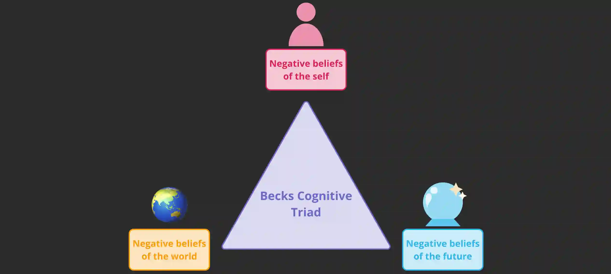
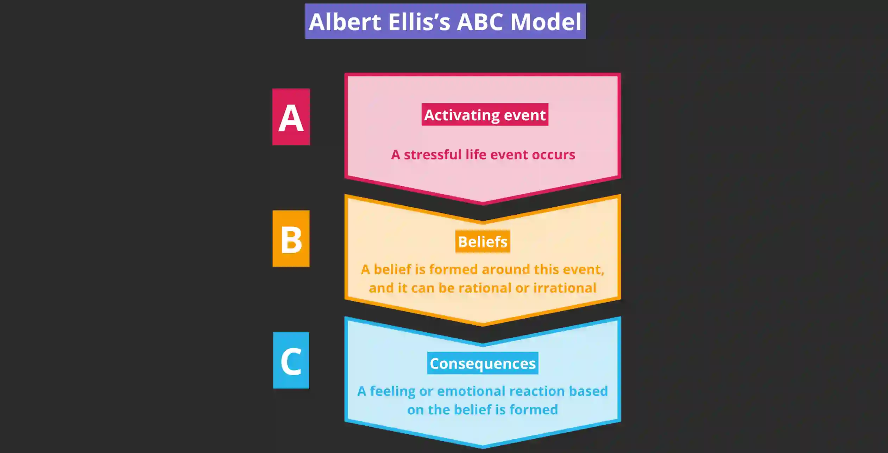

## Cognitive explanations of depression

Cognitive theory examines the processing of information in the brain – how we think

### **Aaron Beck's Cognitive Triad:**

* Comprises three negative thought patterns known as cognitive biases
* Originates from negative experiences in an individual's past (childhood)
  * Experiences related to criticism and/or rejection from *important people* in their life

    * parents, peers, teachers

  * Experiences include:

    * neglect, abuse, bullying, loss/death in family, other forms of loss, overprotective parenting
* This results in a negative self-schema, where the entire belief system is saturated with negativity, causing individuals to perceive every situation as more adverse than it is (magnification; ‘exaggerated’ negative view) – this impacts how people select and process information
  * contradictory evidence that does not support negative beliefs → filtered/ignored

  * evidence that supports/confirms negative beliefs → focused and stored

### **Albert Ellis’s ABC Model**

* Proposes 3 stages that lead to the development of depression

  1. **Activating event:** something happens that triggers a reaction (thoughts)

  2. **Belief(s):** thoughts linked to the event, such as regarding why it happened or how does it define the individual; these can be rational or irrational

  3. **Consequence(s):** the outcome, which refers to an emotional or behavioural reaction; these can be positive (example: acceptance) or negative (example: depressive symptoms)

#|
||

**STRENGTHS**

|

**WEAKNESSES**

||
||

**More holistic explanation:** text

|

**Many factors considered may make it difficult to identify root cause of depression:** text

||
||

**Application to therapeutic settings:** text

|

**Cannot explain all depression cases:** text

||
|#

