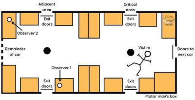

## **Piliavin et. al. (1969) Good Samaritanism**

### **Aims**

1. Investigate real-world bystander intervention in subway settings.
2. Examine factors impacting bystanders' likelihood to offer help.

### **Background**

* Extend research on the bystander effect.
* Explore real-world factors' impact on intervention.
  * This was prompted by the Kitty Genovese case (murder involving people who just watched as Kitty, the victim, was being stabbed several times), highlighting actual behaviour.

### **Participants**

* A field experiment in New York Subway
* Approximately 4,500 passengers were observed between 11 am and 3 pm
* Four groups of four students (two males, two females) using covert observation
* Victim scenario: Male student falling after the first stop
* Victim conditions: Sober with a cane, drunk with a bottle; white or black
* Model actions: Providing help after 70 or 150 seconds or remaining still
* Observers recorded:
  * Number of people in critical and adjacent areas
  * Race and sex of passengers
  * Individuals who offered help
  * Comments made by passengers
  * Time taken to provide assistance

### **Procedure**

* Covert observation for discreet data collection.
* Staged incidents with confederates posing as drunk or ill individuals.
* Record responses of unaware passengers.

### **Results**

* 62 out of 65 times victims had a cane – passengers helped before the model
* 19 out of 38 times, the victim appeared drunk – passengers helped before the model
* In 81 out of 103 trials, the victim was helped before the model planned to help
* In 60% of trials, more than one person helped
* 90% of the first helpers were male
* 64% of the first helpers were white
* 68% of helpers who aided white victims were also white
* 50% of white passengers assisted black victim
* The tendency for same-race helping if the victim appears drunk
* No diffusion of responsibility was found
* Greater speed in helping more people than with fewer

### **Conclusion**

* Revealed factors influencing bystander intervention.
* Contributed to understanding real-world bystander behaviour.
* Emphasized the importance of considering the context in analyzing helping behaviour.

|Strengths|Weaknesses|
|:---|:---|
|Ecological Validity: a natural experiment|Unethical; no Informed consent and protection from harm|
|No demand characteristics; participants unaware of observation||
