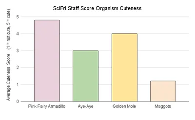
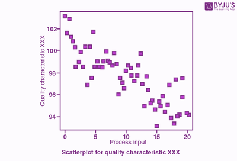
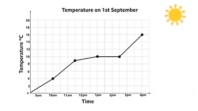
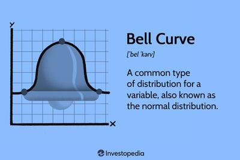
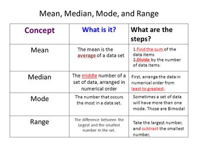

## Mathematical Skills

**Graphs:**

* *Interpretation of Tables, Charts, and Graphs:*
  * Recognize and understand three key graph types:

    1. **Bar Charts:**

       * Utilizes bars for categorical data representation.

       * Bars remain separate due to the discrete nature of the data.

       * **Example:**

         

    2. **Scatter Graphs:**

       * Illustrates correlation between two variables.
       * The line of best fit indicates positive or negative relationships.
       * Example:

       

    3. **Line Graphs:**

       * Depicts change over time with connected data points.
       * Independent and dependent variables on x and y-axes.
       * Example:

       

### **Correlations**

* *Understanding Correlation:*
  * Identify types based on relationships:
    * Positive, Negative, or No Correlation.
    * Examples of each are illustrated with scatter graphs.
  * **Strengths:**
    * Objective use of quantitative data.
    * Facilitates new research opportunities.
  * **Weaknesses:**
    * Unable to establish cause and effect.
    * Limited detail with reliance on quantitative data.

### **Normal Distributions**

* Characteristics of a normal distribution:
  * Bell-shaped, symmetrical curve.
  * Mean, median, and mode align at the central point.
  * Tails never touch the horizontal axis.
* *Creating a Bell Curve:*

**Calculations:**

* **Mean, Median, Mode, Range, Standard Form, Ratios:**

  * Application of calculation methods:

  

### **Percentage Change**

**Method 1:**

1. Calculate the change by subtracting the old value from the new value.
2. Divide the calculated change by the old value to obtain a decimal number.
3. Convert the decimal to a percentage by multiplying it by 100 and adding a "%" sign. Note: If the new value exceeds the old value, it indicates a percentage increase; otherwise, it signifies a decrease.

**Method 2:**

1. Divide the new value by the old value to obtain a decimal number.
2. Convert the resulting decimal to a percentage by multiplying it by 100 and adding a "%" sign.
3. Subtract 100% from the calculated percentage. Note: A positive result indicates a percentage increase, while a negative result implies a decrease (remove the minus sign).